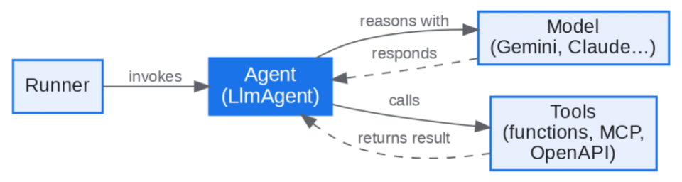

# ADK Core Model and Local Setup

**Module map:** Covers `[3.1]` (custom agents with ADK, model selection, local execution).  
**Prerequisites:** None (start here). **Next:** [02-tools-context-state-and-hooks.md](02-tools-context-state-and-hooks.md)

---

## What ADK Is and Where It Fits `[3.1]`

**Agent Development Kit (ADK)** is Google's open-source, code-first framework for building, debugging, evaluating, and deploying AI agents at enterprise scale. It sits as a structured orchestration layer above raw model APIs: instead of manually wiring context assembly, tool-call parsing, retry loops, and session state, you declare *what* the agent should do (`instruction`, `tools`, `model`) and ADK's runtime handles *how* it executes.

- **Supported languages:** Python, TypeScript, Go, Java, and Kotlin (feature parity varies; **Python** is the most complete).
- **Model agnosticism:** Point `model` at **Gemini**, **Claude**, **Ollama**, or any provider supported by **LiteLLM** without rewriting agent logic.

**Takeaway:** Use ADK when you need managed tool orchestration, multi-step/multi-agent workflows, and built-in debugging/evaluation/deployment rather than hand-rolling a raw LLM API loop.

| Approach | Best When | Trade-off |
|---|---|---|
| **Direct Model API** | Single-turn prompt/response or simple one-off tool call with minimal state. | You own retry logic, schema generation, state tracking, and tracing. |
| **ADK Orchestration** | Multi-step workflows, automatic tool schema generation, multi-agent coordination, or enterprise deployment/eval. | Requires structuring the project around ADK's `Agent` and `Runner` abstractions. |

---

## Core ADK Components `[3.1]`

ADK's execution model revolves around four building blocks:



1. **Agents:** Autonomous units of work.
   - `Agent` (also called `LlmAgent`): Model-backed agent that reasons with an LLM and decides which tools or sub-agents to invoke.
   - **Workflow agents** (deterministic orchestration without model-based routing): `SequentialAgent` (one after another), `ParallelAgent` (concurrently), and `LoopAgent` (repeats until a condition or limit is met).
2. **Models:** Configured per agent via a model identifier string (for example, `"gemini-flash-latest"`).
3. **Tools:** Capabilities the agent can invoke—any Python function passed to `tools=[...]`, plus **OpenAPI** specs and **Model Context Protocol (MCP)** toolsets.
4. **The Runner:** The runtime engine that wires together agents, models, tools, events, and session state. The exact same `Runner` powers local CLI/web testing and production API servers on **Cloud Run** or **GKE** (Google Kubernetes Engine).

**Takeaway:** `Runner` decouples agent definition from hosting—your local `adk web` loop and production **Cloud Run**/**GKE**/**Agent Runtime** service execute the same `Runner` logic.

---

## Configuring a Simple `Agent` `[3.1]`

Every `Agent` requires three parameters and supports several key optional ones:

| Parameter | Required? | Purpose |
|---|---|---|
| `name` | Yes | Unique string identifier for the agent (used in routing and traces). |
| `model` | Yes | Model identifier string (e.g., `"gemini-flash-latest"`). |
| `instruction` | Yes | System prompt defining persona, scope, constraints, and tool-use rules. |
| `description` | Optional | Single-sentence scope summary read by a coordinator agent (or Gemini) to decide when to route tasks to this agent. |
| `tools` | Optional | List of Python functions, MCP toolsets, or OpenAPI tools. |
| `output_key` | Optional | Writes the agent's final text response into session state under that key (e.g., `output_key="billing_response"`). |
| `output_schema` | Optional | Pydantic/type schema enforcing structured JSON output (**incompatible with `tools` on some models**). |

> **Clarification (not in source):** Notice that this course uses `"gemini-flash-latest"` as a rolling model alias, whereas other courses (such as *Build Enterprise Agents with Code Execution*) pin `"gemini-2.5-flash"`. Check current Google Cloud model deprecation/alias guidance before pinning in production.

### Worked Example: Customer Support Billing Agent

```python
from google.adk import Agent

def lookup_account(account_id: str) -> dict:
    """Retrieves the current balance and status for a given billing account.

    Args:
        account_id: The unique identifier for the customer account.
    Returns:
        dict: The account details, or an error status if not found.
    """
    return query_billing_database(account_id)

billing_agent = Agent(
    name="billing_agent",
    model="gemini-flash-latest",
    description="Answers billing and payment questions.",
    instruction="You are a billing specialist. Answer questions about account balances, payment history, and invoices.",
    tools=[lookup_account],
    output_key="billing_response",
)
```

**Cross-check:** `name`, `model`, and `instruction` are present; `description` enables future coordinator routing; `output_key` persists the final answer into session state; and `tools` uses a typed, documented Python function without `output_schema` (avoiding the tools + `output_schema` incompatibility).

---

## Running an Agent Locally `[3.1]`

ADK provides a CLI workflow for scaffolding and testing before cloud deployment:

- `adk create my_agent`: Scaffolds the agent directory with `agent.py`, `__init__.py` *(source capture wrote `init.py`—see Clarification below)*, and `.env` (for API keys / Vertex AI config).
- **`root_agent` convention:** The runner discovers your entry agent via the module-level variable `root_agent` inside `agent.py`.
- `adk run my_agent`: Starts an interactive terminal REPL.
- `adk web`: Launches a browser-based dev UI at `http://localhost:8000` with a chat panel on the left and an execution trace view on the right.
- `adk api_server`: Starts an HTTP server streaming responses using the same `Runner`.

> **Clarification (not in source):** The raw course capture wrote `init.py`, which is a transcription artifact; standard Python/ADK packages use `__init__.py` (double underscores) to expose `agent.py` and `root_agent`.

**Takeaway:** Always expose `root_agent` in `agent.py` so `adk run`, `adk web`, `adk api_server`, and cloud deployment targets can discover the entry point identically.

---

## Common Confusions

| Confusion | Reality |
|---|---|
| `Agent` vs `LlmAgent` | They refer to the same primary model-backed agent class in ADK (`Agent` is the standard alias). |
| `instruction` vs `description` | `instruction` guides *this* agent's internal behavior; `description` tells a *parent coordinator* (or Gemini) *when* to delegate to this agent. |
| `output_key` vs `output_schema` | `output_key` saves the final response into session state; `output_schema` constrains the response format to structured JSON (and cannot be combined with `tools` on some models). |
| `adk web` vs `adk api_server` | `adk web` is the interactive dev UI (`localhost:8000`) with trace inspection; `adk api_server` exposes a programmatic HTTP streaming endpoint. |
