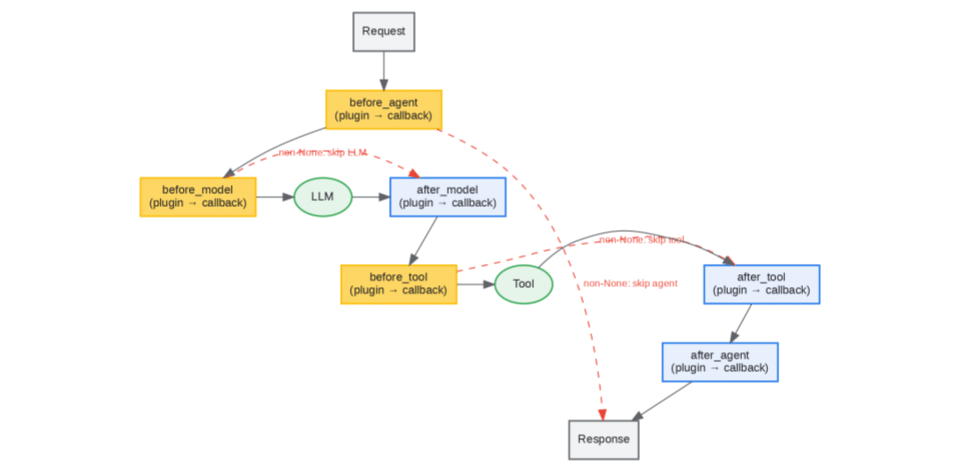

# ADK Tools, Context, State, and Lifecycle Hooks

**Module map:** Covers `[3.1]` (tools, `ToolContext`, session state, callbacks/plugins) and `[5.2]` (deterministic authorization and guardrail hooks).  
**Prerequisites:** [01-adk-core-model-and-setup.md](01-adk-core-model-and-setup.md). **Next:** [03-multi-agent-orchestration-and-adk2.md](03-multi-agent-orchestration-and-adk2.md)

---

## How ADK Builds Tool Schemas `[3.1]`

A **tool schema** is the JSON specification sent to the LLM describing a function's name, purpose, parameters, and types so the model knows *when* and *how* to call it. ADK generates this schema automatically from three parts of a Python function:

1. **Function Name:** Becomes the tool name—use specific action verbs (e.g., `lookup_account`, not `get_data`).
2. **Docstring:** The model's primary guide for *when* and *why* to call the tool, what each parameter expects, and what return shapes (including error dicts like `{"status": "error"}`) look like.
3. **Type Hints:** Annotate every parameter and return type so ADK emits valid JSON types.

- **Inter-tool ordering:** If tool A must run before tool B, state that dependency explicitly in the agent's `instruction`.
- **Critical `ToolContext` rule:** Never document `tool_context: ToolContext` in the docstring—ADK injects it automatically at runtime and hides it from the model-facing schema.

**Takeaway:** Specific function names, complete type hints, and clear docstrings (omitting `ToolContext`) directly determine tool-calling accuracy.

---

## `ToolContext`: Trusted Capabilities Beyond Model Args `[3.1]` `[5.2]`

**`ToolContext`** is a runtime object injected into a Python tool function to give your deterministic code access to session state, flow control, artifacts, and auth—without exposing those controls to LLM parameter hallucination or prompt injection.

| Capability | API | Purpose & Security Value |
|---|---|---|
| **State Access** | `tool_context.state` | Read/write session state; application-set keys (e.g., `session_user_id`) **cannot be forged by the LLM**. |
| **Flow Control** | `tool_context.actions` | Set `transfer_to_agent = "agent_name"`, `escalate = True`, or `skip_summarization = True`. |
| **Artifacts** | `load_artifact(name)` / `save_artifact(name, data)` | Store/retrieve large binary objects (PDFs, images) outside event payloads. |
| **Authentication** | `request_credential(auth_config)` / `get_auth_response()` | Initiate OAuth/credential flows for external APIs. |

### Worked Example: Preventing Horizontal Privilege Escalation

```python
def fetch_account(account_id: str, tool_context: ToolContext) -> dict:
    """Returns account data for the authenticated user."""
    # session_user_id is set by the app at session start, not supplied by the LLM
    authorized_id = tool_context.state.get("session_user_id")
    if account_id != authorized_id:
        return {"error": "Access denied."}
    return lookup_account(account_id)
```

**Cross-check:** Even if a prompt injection tricks the LLM into passing `account_id="victim_123"`, `tool_context.state.get("session_user_id")` is server-controlled, so the tool deterministically rejects the call.

**Takeaway:** Enforce identity and authorization checks inside `ToolContext`-backed Python code rather than relying on LLM instructions alone.

---

## Session State Scopes and Safe Write Channels `[3.1]`

**Session state** is a key-value store shared across agents and turns. ADK uses **key prefixes** to control visibility and lifetime:

| Prefix | Scope | Lifetime & Visibility |
|---|---|---|
| *(none)* | **Session-scoped** | Visible to all agents in the current conversation; isolated from other sessions. |
| `user:` | **User-scoped** | Persists across all sessions for a given user. |
| `app:` | **App-scoped** | Shared across all users of the application. |
| `temp:` | **Invocation-scoped** | Shared within a single invocation; cleared when the invocation ends. |

- **Instruction template substitution:** Inject state into `instruction` using `{key}` (required) or `{key?}` (optional, e.g., `"{user:language?}"`).
- **Safe write channels:** Always write state via `output_key` on an `Agent`, `tool_context.state`, or `callback_context.state`. **Never mutate `session.state` directly** outside managed contexts—ADK tracks state deltas through these channels across `InMemorySessionService`, `DatabaseSessionService`, and `VertexAiSessionService`.
- **Best practice:** Define state key names, prefixes, and expected value shapes in a shared constants module.

**Takeaway:** Use scope prefixes (`user:`, `app:`, `temp:`, or unprefixed) and write only through `output_key`, `tool_context.state`, or `callback_context.state` so persistence services track deltas reliably.

---

## Callbacks and Plugins: Lifecycle Instrumentation `[3.1]` `[5.2]`

ADK exposes **six callback checkpoints** in three before/after pairs (`before_agent` / `after_agent`, `before_model` / `after_model`, `before_tool` / `after_tool`) plus **runner-level plugins (`BasePlugin`)**:



- **Short-circuiting rule:** Returning `None` from a callback/plugin lets execution continue normally. Returning a non-`None` response object (e.g., `LlmResponse` from `before_model_callback`) **short-circuits** the next step and skips the underlying LLM or tool call.
- **Plugins (`BasePlugin`) vs Agent Callbacks:**
  - **Plugins** are registered once on the `Runner` (`InMemoryRunner(..., plugins=[LoggingPlugin()])`), shared across all invocations, and run **before** any agent-level callbacks. They also expose hooks on incoming user messages, run start, and model/tool errors.
  - **Callbacks** are attached to individual `Agent` instances (e.g., `before_model_callback=block_restricted`).

> **Clarification (not in source):** The text capture explicitly names `before_model_callback` and `after_model_callback`, while the diagram and plugin snippet confirm the other four checkpoints (`before_agent`, `after_agent`, `before_tool`, `after_tool`).

### Worked Example: Guardrail Callback + Global Logging Plugin

```python
def block_restricted(callback_context: CallbackContext, llm_request: LlmRequest):
    last = llm_request.contents[-1].parts[0].text if llm_request.contents else ""
    if "RESTRICTED" in last.upper():
        return LlmResponse(content=types.Content(role="model",
            parts=[types.Part(text="That request can't be processed.")]))
    return None

class LoggingPlugin(BasePlugin):
    def __init__(self):
        super().__init__(name="logging")

    async def before_tool_callback(self, *, tool, tool_args, tool_context):
        print(f"[{tool.name}] called with {tool_args}")
```

**Cross-check:** `LoggingPlugin` runs on the `Runner` before every tool call across all agents; `block_restricted` runs on a specific `Agent` before the LLM call and short-circuits with an `LlmResponse` when `"RESTRICTED"` appears.

**Takeaway:** Use `BasePlugin` on the `Runner` for cross-cutting observability/policy, and `Agent` callbacks for agent-specific guardrails and short-circuiting.

---

## Common Confusions

| Confusion | Reality |
|---|---|
| Documenting `ToolContext` in docstring | Never document `ToolContext` in the tool docstring; ADK injects it automatically and hides it from the LLM schema. |
| Mutating `session.state` directly | Bypasses ADK's delta tracking; always use `output_key`, `tool_context.state`, or `callback_context.state`. |
| Plugin vs Callback execution order | Runner `BasePlugin` hooks always execute **before** the corresponding `Agent` callback. |
| Returning `None` vs object in a callback | `None` = continue normal execution; non-`None` = short-circuit and skip the upcoming agent/model/tool step. |
