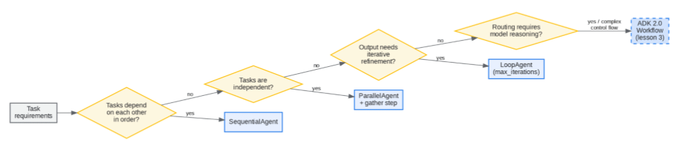

# Multi-Agent Orchestration: Template Workflows and ADK 2.0

**Module map:** Covers `[3.3]` (multi-agent orchestration, workflow patterns, graph workflows, delegation modes) and `[3.1]` (code-first agent design).  
**Prerequisites:** [01-adk-core-model-and-setup.md](01-adk-core-model-and-setup.md), [02-tools-context-state-and-hooks.md](02-tools-context-state-and-hooks.md). **Next:** [04-grounding-enterprise-data-and-mcp.md](04-grounding-enterprise-data-and-mcp.md)

---

## Why Multi-Agent Systems Matter `[3.3]`

Splitting a monolithic agent into specialized sub-agents solves three scaling bottlenecks:
1. **Context Window Limits:** Each agent sees only the instructions, tools, and history relevant to its slice.
2. **Task Specialization:** Narrow `instruction`, small tool sets, and clean domain policy boundaries improve accuracy.
3. **Parallelism:** Independent subtasks execute concurrently rather than serially.



**Takeaway:** Move from a single agent to multiple agents when tool count, instruction complexity, or sequential latency degrades quality.

---

## Template Workflow Agents (Deterministic) `[3.3]`

Template workflow agents orchestrate sub-agents deterministically in code without spending LLM tokens on routing:

| Workflow Agent | Execution Pattern | Key Rule / Pattern |
|---|---|---|
| `SequentialAgent` | Runs `sub_agents` one after another in order. | Shares the same invocation context; pass outputs forward via `output_key` + `{key}` templates. |
| `ParallelAgent` | Runs independent `sub_agents` concurrently. | Pair with a subsequent sequential gather/synthesis step to merge results. |
| `LoopAgent` | Repeats sub-agents iteratively until a condition is met. | **Always set `max_iterations` defensively** to prevent infinite loops and runaway cost. |

**Takeaway:** Use `SequentialAgent`, `ParallelAgent`, and `LoopAgent` when the control flow is fixed and predictable.

---

## ADK 2.0 Graph Workflows (`Workflow`, `Event`, `JoinNode`) `[3.3]`

When workflows need **conditional branching**, **fan-out/fan-in**, or mixed **code + LLM nodes**, ADK 2.0 introduces an explicit directed-graph `Workflow` class:

- **Node types:** `Agent` instances, plain Python functions (auto-wrapped in `Event`, context-injected, Pydantic-validated), tools, or nested `Workflow` instances.
- **Reserved entry node:** `"START"`.
- **Conditional routing:** A router node returns `Event(route=...)`, matched against an edge dictionary `(router, {"ROUTE_A": agent_a, ...})`.
- **Parallel fan-out & join:** Multiple outgoing edges from a source node without route conditions run concurrently and converge at `JoinNode(name="join")`.
- **Typed node contracts:** Use `input_schema` and `output_schema` with Pydantic models and reference fields in instructions via `{ClassName.property}`. Keep large payloads in ADK **artifacts** or external stores rather than event payloads.

### Worked Example: Conditional Routing vs Parallel Fan-Out/Join

```python
from google.adk import Agent, Workflow, Event, JoinNode

def router(node_input: str):
    return Event(route=node_input.strip())

# Conditional routing
conditional_workflow = Workflow(
    name="support_workflow",
    edges=[
        ("START", classifier, router),
        (router, {"BILLING": billing_agent, "SHIPPING": shipping_agent}),
    ],
)

# Parallel fan-out & join
join = JoinNode(name="join")
parallel_workflow = Workflow(
    name="multi_category_workflow",
    edges=[
        ("START", classifier, router),
        (router, billing_agent),
        (router, shipping_agent),
        (billing_agent, join),
        (shipping_agent, join),
        (join, synthesizer),
    ],
)
```

**Cross-check:** In `conditional_workflow`, `router` returns `Event(route=...)` to select one edge from the dict; in `parallel_workflow`, unconditioned edges from `router` execute `billing_agent` and `shipping_agent` concurrently and synchronize at `join` before `synthesizer`.

**Takeaway:** Use ADK 2.0 `Workflow` with `Event(route=...)` for deterministic branching and `JoinNode` for parallel fan-out/fan-in graphs.

---

## Task-Based Collaboration (`mode` on `sub_agents`) `[3.3]`

When a coordinator `Agent` routes dynamically using LLM reasoning, ADK auto-generates `request_task_<sub_agent>` tools and supports three delegation modes via the `mode` parameter:

| Mode | Control & Interaction | Concurrency | Best For |
|---|---|---|---|
| **Chat mode** *(default)* | Transfers full conversation; control returns only via an explicit transfer call. | Sequential | Open-ended multi-turn handoffs where the specialist owns the user chat. |
| **Task mode** (`mode="task"`) | Scoped task delegation where the specialist may interact with the user, then returns control. | Sequential | Multi-turn specialist subtasks (e.g., gathering missing fields for a return). |
| **Single-turn mode** (`mode="single_turn"`) | One-shot delegation returning a structured result directly to the coordinator. | **Parallel** (when multiple are called in one turn) | Fast, independent lookups/analyses aggregated by the coordinator. |

### Three Architectural Constraints for `task` and `single_turn`
1. **Leaf nodes only:** `task` and `single_turn` sub-agents cannot define their own `sub_agents`.
2. **Auditability:** Each delegation is recorded as a dedicated branch in the session audit trail.
3. **Bidirectional context isolation:** Specialists see only what the coordinator passes; the coordinator sees only the tool-call record and structured response (not the specialist's internal reasoning).

**Takeaway:** Choose `single_turn` for parallelizable structured lookups, `task` for scoped interactive subtasks, and default `chat` mode for full conversation transfers.

---

## Common Confusions

| Confusion | Reality |
|---|---|
| `SequentialAgent` vs ADK 2.0 `Workflow` | `SequentialAgent` is a fixed linear pipeline; `Workflow` supports conditional routing (`Event(route=...)`), mixed Python/agent nodes, and `JoinNode` fan-in. |
| `task` vs `single_turn` delegation | `task` runs sequentially and can talk to the user; `single_turn` runs in parallel (if multiple are invoked) and returns a structured result without user interaction. |
| Nesting under `task`/`single_turn` | Not allowed—`task` and `single_turn` sub-agents must be **leaf nodes** with no `sub_agents`. |
| Passing large files in `Workflow` events | Anti-pattern; store large payloads in ADK **artifacts** (`tool_context.save_artifact`) or external storage and pass references. |
