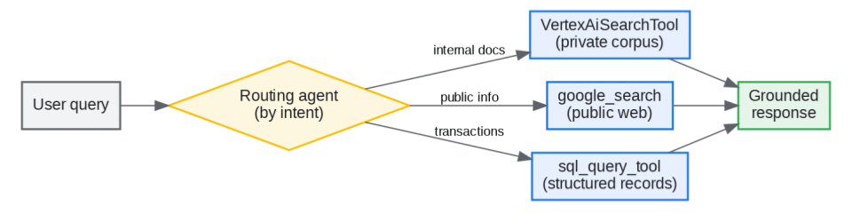

# Grounding, Enterprise Data Integration, and MCP

**Module map:** Covers `[3.2]` (RAG, vector retrieval, custom integration layers, MCP servers) and `[1.2]` (enterprise data & grounding concepts, partial).  
**Prerequisites:** [02-tools-context-state-and-hooks.md](02-tools-context-state-and-hooks.md). **Next:** [05-deploying-and-sharing-in-gemini.md](05-deploying-and-sharing-in-gemini.md)

---

## Grounding and Built-In Retrieval Tools `[3.2]` `[1.2]`

**Grounding** anchors every model response to content retrieved at query time from a controlled source, returning **grounding metadata** for citation and auditing rather than relying on parametric memory.



| Source Type | ADK Tool | Key Requirement / Constraint |
|---|---|---|
| **Public Web** | `google_search` (`from google.adk.tools import google_search`) | Live public web grounding with citations. |
| **Private Enterprise Docs** | `VertexAiSearchTool` (`from google.adk.tools import VertexAiSearchTool`) | Queries **Agent Search** datastore (`projects/PROJECT/locations/global/collections/default_collection/dataStores/DATASTORE`). Requires `GOOGLE_GENAI_USE_VERTEXAI=TRUE` (**Google AI Studio is not supported**). |
| **Structured / Transactional** | Custom Python function tools | Backed by **BigQuery**, relational DBs, or **REST APIs**. |

- **Routing guardrails:** Write explicit routing rules in `instruction` (which tool for which intent) and forbid answering factual claims from memory when a tool applies. As routing rules grow, extract them into a dedicated routing sub-agent using `transfer_to_agent`.

**Takeaway:** Pair explicit routing instructions with dedicated tools per source—and remember `VertexAiSearchTool` requires Vertex AI (`GOOGLE_GENAI_USE_VERTEXAI=TRUE`), never Google AI Studio.

---

## Structured vs. Unstructured Data & Failure Modes `[3.2]`

| Data Type | Answers | Primary Failure Mode | Mitigation |
|---|---|---|---|
| **Structured** (SQL, CRM, transactions) | **"What"** (balances, orders, inventory) | **Schema hallucination** (inventing table/column names) | Custom Python tools with `ToolContext` auth checks, or a two-step retrieval sequence injecting approved schemas/queries before SQL generation. |
| **Unstructured** (PDFs, policies, wikis) | **"Why"** (rules, procedures, explanations) | **Semantic drift** (retrieving topically similar but wrong chunks) | Use `VertexAiSearchTool`, or wrap **Vector Search 2.0** (`vectorsearch` API) in a custom tool for hybrid semantic+keyword search, metadata filtering, or custom ranking. |

- **One tool per knowledge base:** Give each knowledge base its own dedicated custom tool so the model routes cleanly and can call both to synthesize mixed questions.

**Takeaway:** Mitigate **schema hallucination** on structured data with typed Python/`ToolContext` tools, and mitigate **semantic drift** on unstructured data with `VertexAiSearchTool` or hybrid **Vector Search 2.0**.

---

## Connecting External Tools and Data with MCP (`McpToolset`) `[3.2]`

**Model Context Protocol (MCP)** is an open standard for connecting AI agents to external tool servers and data sources (such as **Pinecone**, **Spanner**, **Bigtable**, and **MongoDB**). ADK supports both **MCP client** (`McpToolset`) and **MCP server** modes.

| Transport Class | When to Use |
|---|---|
| `StdioConnectionParams` (`StdioServerParameters`) | Local processes or sidecar containers communicating over stdin/stdout. |
| `StreamableHTTPConnectionParams` | Remote production HTTP MCP servers. |

- **Least-privilege filtering:** Always restrict exposed tools with `tool_filter=[...]` rather than exposing an entire MCP server's tool catalog.
- **Critical deployment rule:** Define the agent and `McpToolset` **synchronously in `agent.py`**. Async factory functions work locally in `adk web` but **fail on Cloud Run, GKE, and Agent Runtime**.

### Worked Example: Least-Privilege Local MCP Toolset

```python
from google.adk.tools.mcp_tool import McpToolset
from google.adk.tools.mcp_tool.mcp_session_manager import StdioConnectionParams
from mcp import StdioServerParameters

toolset = McpToolset(
    connection_params=StdioConnectionParams(
        server_params=StdioServerParameters(
            command="npx",
            args=["-y", "@modelcontextprotocol/server-filesystem", "/data"],
        )
    ),
    tool_filter=["list_directory", "read_file"],
)
```

**Cross-check:** `toolset` is instantiated synchronously at module level (safe for Cloud Run/GKE/Agent Runtime) and uses `tool_filter` to grant read-only directory/file access instead of write/delete tools.

**Takeaway:** Use `McpToolset` with `tool_filter` for least privilege, `StreamableHTTPConnectionParams` for remote servers, and synchronous `agent.py` definitions for cloud deployment.

---

## Common Confusions

| Confusion | Reality |
|---|---|
| Using `VertexAiSearchTool` with AI Studio | Fails—`VertexAiSearchTool` requires Google Cloud (`GOOGLE_GENAI_USE_VERTEXAI=TRUE`). |
| Async `McpToolset` factory in `agent.py` | Works in `adk web` locally, **fails** when deployed to Cloud Run, GKE, or Agent Runtime. |
| Exposing all MCP tools | Violates least privilege and bloats context; always pass `tool_filter=[...]`. |
| Schema hallucination vs Semantic drift | Schema hallucination = inventing SQL columns/tables (structured); semantic drift = retrieving off-target text chunks (unstructured). |
