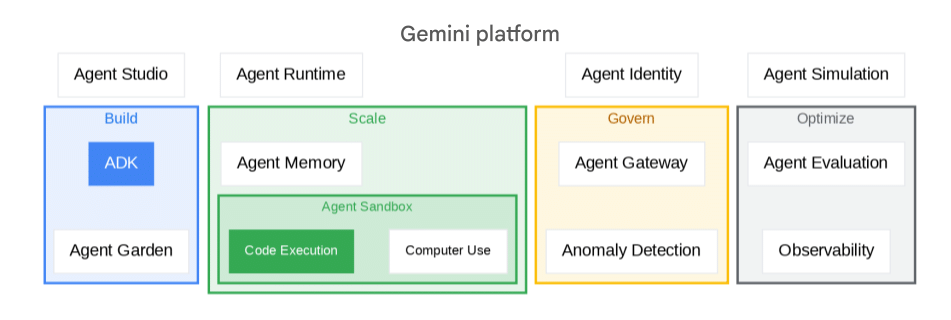

# Gemini Platform and the Agent Sandbox

**Module map:** Covers `[5.2]` (secure agent behavior, untrusted code isolation) and `[4.2]` (Agent Runtime vs Agent Sandbox architecture).  
**Prerequisites:** None (start here). **Next:** [02-sandbox-lifecycle-state-and-sdk.md](02-sandbox-lifecycle-state-and-sdk.md)

---

## The Untrusted Code Execution Problem `[5.2]`

Data analysis, chart generation, and complex math often require an agent to **generate and execute Python code dynamically at runtime** based on user prompts and external files (such as uploaded CSVs). Because model-generated code is **untrusted**—potentially buggy, malformed, or manipulated via prompt injection—running it inside the same runtime as your production agent risks host compromise, data exfiltration, or lateral movement.

**Agent Sandbox** solves this by placing an isolated execution boundary inside the **Gemini platform** specifically for untrusted workloads.

**Takeaway:** Never run model-generated code in your trusted agent process; isolate it inside **Agent Sandbox**.

---

## Gemini Platform Architecture and the Scale Pillar `[4.2]`

The **Gemini platform** (evolved in April 2026) consolidates agent development and operations into four capability areas:

1. **BUILD:** **Agent Studio** (low-code), **ADK** (code-first), sub-agents, **Agent Garden** templates, batch/event-driven agents.
2. **SCALE:** Runs agents reliably and safely in production—houses **Agent Runtime**, **Agent Sandbox**, **Agent Memory Bank**, and **Agent Sessions**.
3. **GOVERN:** **Agent Identity**, **Agent Gateway**, and **Anomaly Detection** for enterprise compliance.
4. **OPTIMIZE:** **Agent Evaluation**, **Agent Simulation**, and **Observability**.

- **Parent resource — Agent Engine:** In the API/SDK, **Agent Engine** is the top-level container resource that owns your sandboxes. It must be created **before** provisioning a sandbox and persists across the sandbox lifecycle.

### Trust Domain Split: Agent Runtime vs. Agent Sandbox `[4.2]` `[5.2]`

| Dimension | Agent Runtime | Agent Sandbox |
|---|---|---|
| **Trust Domain** | **Trusted** (runs vetted, developer-written code). | **Untrusted / Isolated** (runs dynamically synthesized model code). |
| **Lifecycle & Persistence** | Long-running with **sub-second cold starts**. | Short-lived, typically **ephemeral**; retains state **up to 14 days** and is cleaned up after use. |
| **Responsibilities** | Reasoning, tool orchestration, memory access, session management. | Computations, file processing, data analysis, chart generation, browser automation. |
| **System & Network Access** | Appropriate access to enterprise infrastructure. | **No network access**, **limited filesystem**, and **no ability** to affect Agent Runtime or other systems. |

### Two Agent Sandbox Execution Modes
1. **Code Execution** *(focus of this module)*: Sandboxed **Python** (or **JavaScript**) interpreter operating on files to compute metrics, analyze data, and generate charts.
2. **Computer Use:** Sandboxed browser environment for automating web UI tasks (navigating sites, filling forms).

**Takeaway:** **Agent Runtime** runs trusted developer code with enterprise access; **Agent Sandbox** runs untrusted model code with zero network access and strict containment.

---

## Three Security & Isolation Properties `[5.2]`

Agent Sandbox provides a bounded, auditable attack surface suited for regulated industries:

1. **Containment:** Code inside a sandbox cannot access host resources, the host filesystem, or internal/external networks. Attempts to read host environment variables, call internal services, or `pip install` packages fail at the boundary.
2. **Tenant Isolation:** Each sandbox is strictly isolated from other sandboxes in the **same project** and from **other customers**—critical when multiple analysts run queries concurrently.
3. **Predictability:** Ships with a fixed pre-installed set of **125+ packages** (including **NumPy**, **Pandas**, **Matplotlib**, **scikit-learn**). Agents cannot install arbitrary packages or call external services at runtime.

### Worked Example: External CSV Analysis

A customer service agent ingests CSVs from external sources and generates Python to compute trends. Even if an adversarial CSV triggers unexpected code generation, **Containment** blocks outbound exfiltration/host access, **Tenant Isolation** protects other concurrent users, and **Predictability** prevents malicious package installation—limiting blast radius to an isolated sandbox error.

**Takeaway:** **Containment**, **Tenant Isolation**, and **Predictability** make Agent Sandbox safe for multi-tenant, regulated enterprise deployments.

---

## Common Confusions

| Confusion | Reality |
|---|---|
| **Agent Engine** vs **Agent Runtime** | **Agent Engine** is the parent container resource in the API/SDK (`client.agent_engines`) that owns sandboxes and deployments; **Agent Runtime** is the trusted execution environment in the **Scale** pillar. |
| **Code Execution** vs **Computer Use** | Both are **Agent Sandbox** modes: Code Execution runs Python/JS in a sandboxed interpreter; Computer Use automates a sandboxed browser. |
| Installing packages at runtime in Sandbox | Not possible—the sandbox has **no network access** and uses a fixed pre-installed set of **125+ packages**. |
