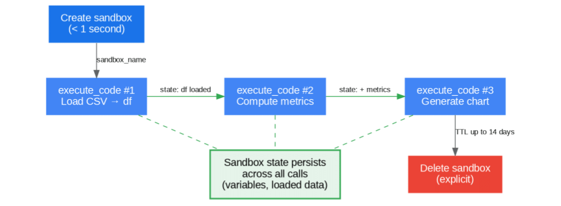

# Sandbox Lifecycle, State, and the Agent Platform SDK

**Module map:** Covers `[3.1]` (SDK usage, state persistence) and `[4.2]` (sandbox compute tiers, region constraints, lifecycle).  
**Prerequisites:** [01-gemini-platform-and-agent-sandbox.md](01-gemini-platform-and-agent-sandbox.md). **Next:** [03-adk-code-execution-and-cleanup.md](03-adk-code-execution-and-cleanup.md)

---

## Regional Constraint & Three-Stage Lifecycle `[4.2]`

- **Region constraint:** Code Execution is supported **only in `us-central1`** *(as of June 3, 2026)*. Explicitly set `location="us-central1"` when initializing the `vertexai` client if your project defaults elsewhere.



1. **Create:** Initializes in **under 1 second** under a parent **Agent Engine**. Requires `display_name` and `code_execution_environment`.
2. **Execute:** Runs code via `execute_code`, returning outputs while **preserving in-memory state** (variables, imported libraries, loaded DataFrames) across any number of sequential calls to the **same** sandbox.
3. **Delete:**
   - **Sliding TTL:** Configurable up to **14 days**. Every `execute_code` call **resets the TTL timer**, keeping active sessions alive.
   - **Manual cleanup:** Call `delete` immediately when a session ends.
   - **Cascading cleanup:** Deleting the parent Agent Engine with `force=True` deletes all child sandboxes.

- **State isolation:** State persists across sequential `execute_code` calls within one sandbox, but **never** across different sandboxes.

**Takeaway:** A single sandbox acts like a stateful notebook kernel (variables/DataFrames persist across `execute_code` calls, and each call resets the 14-day max TTL), available only in `us-central1`.

---

## Compute Tiers and Pre-Installed Libraries `[4.2]`

| Tier | Specs | `machine_config` Key | Use Case |
|---|---|---|---|
| **Default** | **2 vCPU, 1.5 GB RAM** | *(Omitted / default)* | Standard data analysis and charting. |
| **Large** | **4 vCPU, 4 GB RAM** | `"MACHINE_CONFIG_VCPU4_RAM4GIB"` | Memory- or CPU-heavy workloads (e.g., training `scikit-learn` on large datasets). |

- **Fixed library set (125+ packages, as of June 3, 2026):**
  - Data: `NumPy 2.1.3`, `Pandas 2.2.3`, `SciPy 1.15.2`
  - ML: `scikit-learn 1.6.1`, `XGBoost 3.2.0`
  - Visualization: `Matplotlib 3.10.1`, `Plotly 6.1.2`, `Seaborn 0.13.2`
  - File I/O: `openpyxl`, `PyPDF2`

> **Gap:** The course notes Code Execution supports Python or JavaScript, but only `"code_language": "LANGUAGE_PYTHON"` is shown in the capture; verify the JavaScript enum string in official docs if needed.

**Takeaway:** Choose `"MACHINE_CONFIG_VCPU4_RAM4GIB"` for ML/large datasets, and design within the 125+ pre-installed libraries since runtime `pip install` is blocked.

---

## Agent Platform SDK Operations (`client.agent_engines.sandboxes`) `[3.1]`

The `vertexai` client library exposes five operations under `client.agent_engines.sandboxes`:

| Operation | Purpose & Key Parameters |
|---|---|
| `create` | Provisions a sandbox under a parent Agent Engine (`name=agent_engine.api_resource.name`, `config=types.CreateAgentEngineSandboxConfig(...)`, `spec`). Returns an LRO whose `.response.name` is `sandbox_resource_name`. |
| `execute_code` | Runs code (`name=sandbox_resource_name`) with `input_data={"code": ..., "files": [{"name": ..., "content": <bytes>}]}`. Optional `files` are written to the working directory before execution. |
| `get` | Fetches a single sandbox resource by name. |
| `list` | Lists all sandboxes belonging to a parent Agent Engine. |
| `delete` | Immediately terminates and removes a sandbox. |

### Parsing `response.outputs` (`Chunk` Objects)

`execute_code` returns `response.outputs` as a list of `Chunk` objects (`data`, `mime_type`, `metadata`):
- **Stdout / Stderr:** `mime_type == "application/json"` and `metadata is None` -> decode UTF-8 JSON and read `"msg_out"` (stdout) and `"msg_err"` (stderr).
- **Generated File Artifacts (e.g., PNG charts):** `metadata.attributes["file_name"]` (decode from `bytes` to `utf-8` if needed) + raw file bytes in `output.data`.

### Worked Example: Stateful Multi-Call Execution & Output Parsing

```python
import json

# Call 1: load CSV into sandbox memory
client.agent_engines.sandboxes.execute_code(
    name=sandbox_resource_name,
    input_data={
        "code": "import pandas as pd\ndf = pd.read_csv('data.csv')",
        "files": [{"name": "data.csv", "content": csv_bytes}],
    },
)

# Call 2: df persists in memory; compute and print summary
response = client.agent_engines.sandboxes.execute_code(
    name=sandbox_resource_name,
    input_data={"code": "print(df.pct_change().dropna().describe())"},
)

for output in response.outputs:
    if output.mime_type == "application/json" and output.metadata is None:
        result = json.loads(output.data.decode("utf-8"))
        print(result.get("msg_out"))
    elif output.metadata and output.metadata.attributes:
        file_name = output.metadata.attributes.get("file_name")
        if isinstance(file_name, bytes):
            file_name = file_name.decode("utf-8")
        # output.data holds raw artifact bytes
```

**Cross-check:** `data.csv` is uploaded in Call 1, `df` remains in memory for Call 2 without reloading, and `response.outputs` separates JSON stdout/stderr chunks from binary file artifact chunks via `metadata.attributes["file_name"]`.

**Takeaway:** Use `input_data["files"]` to stage inputs and branch on `mime_type` + `metadata` to extract stdout/stderr vs binary artifacts from `response.outputs`.

---

## Common Confusions

| Confusion | Reality |
|---|---|
| TTL is a fixed 14-day hard cutoff | **Sliding TTL:** every `execute_code` call resets the TTL timer (up to 14 days idle). |
| Sandbox state across sandboxes | Memory persists across `execute_code` calls **within one sandbox** only; a new sandbox starts clean. |
| Default vs Large compute | Default is **2 vCPU / 1.5 GB RAM**; Large is **4 vCPU / 4 GB RAM** (`"MACHINE_CONFIG_VCPU4_RAM4GIB"`). |
| Reading `stdout` from `response.outputs` | It's inside a `mime_type == "application/json"` chunk (`metadata is None`) under key `"msg_out"`, not plain text. |
