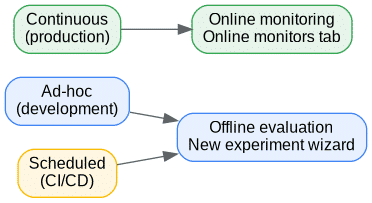
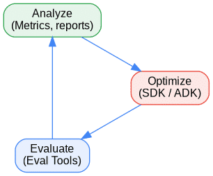
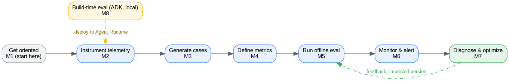

# Quality Flywheel and Evaluation Modes

**Module map:** Covers **[4.1]** (evaluating agents in development and production; choosing evaluation tooling) and **[4.2]** (monitoring agents).
**Prerequisites:** None (start here). **Next:** [02-telemetry-contract-and-trace-debugging.md](02-telemetry-contract-and-trace-debugging.md).

---

## 1. Agent Evaluation vs. Traditional Model Evaluation `[4.1]`

**What it is:** Traditional model evaluation grades a single prompt-response pair in isolation. **Agent evaluation** assesses multi-step, tool-using agent behavior across multiple turns—including tool selection, parameter passing, and conversation flow.

**Why it exists:** A final answer can look well-written even when the execution path was wrong—for example, when an agent called the wrong tool, passed an invalid parameter, or drifted from the user's goal over several turns. Because the Gemini platform evaluates recorded behavior rather than only the final text, it grades what the agent actually *did*, not just what it last *said*.

| Dimension | Traditional Model Evaluation | Agent Evaluation |
| :--- | :--- | :--- |
| **Unit graded** | Single prompt and single response | Multi-step execution across turns (inputs, tool calls, parameters, responses) |
| **Failure visibility** | Only sees bad final text | Catches wrong tool selection, bad parameters, and multi-turn drift |
| **Data source** | Static prompt/answer pairs | Recorded **traces** and **sessions** |

> **Takeaway:** Always evaluate the full execution path (tool calls, arguments, and multi-turn state), because a plausible final response can hide a broken tool trajectory.

---

## 2. Core Evaluation Vocabulary `[4.1]`

Define these terms once; every later workflow on the Gemini platform builds on them:

- **Deployed Agent:** An Agent Development Kit (ADK) agent hosted on **Agent Runtime** on the Gemini platform.
- **Trace:** An immutable record of a single agent invocation (one conversational turn), capturing model inputs, tool calls, and responses in sequential order.
- **Session:** A complete multi-turn conversation between a user and the agent, grouping one or more traces.
- **Eval Case:** A test scenario executed by the agent, always beginning with a starting prompt. *Graded cases* include a reference answer and expected tool calls; *ungraded cases* provide only the starting prompt.
- **Metric:** A rule that evaluates a specific aspect of agent behavior and returns a score. *Single-turn metrics* grade individual prompts and responses; *multi-turn metrics* grade entire conversations.
- **Experiment:** An offline evaluation run and its generated report, launched and reviewed in the **Experiments** tab.
- **Online Monitor:** A scheduled job that evaluates a sample of live production traffic in real time to detect quality drift.
- **Issue Cluster / Failure Cluster:** A grouping of failures that share a common root cause. Fixing the root cause of a cluster resolves multiple failing cases at once.
- **Evaluation Suite:** The comprehensive platform toolset used to measure agent performance across tasks.
- **Quality Flywheel (and Quality Flywheel Lap):** The iterative *evaluate → analyze → optimize* hill-climbing loop. Each completed pass (**lap**) feeds an improved agent version back into evaluation so quality compounds over time.

> **Takeaway:** A **trace** is one turn, a **session** is the full multi-turn conversation, and the **Quality Flywheel** turns those recorded runs into continuous, compounding improvements.

---

## 3. Offline Evaluation vs. Online Monitoring `[4.1]` `[4.2]`

**What it is:** The Gemini platform provides two complementary evaluation modes—**offline evaluation** and **online monitoring**—that share the exact same underlying evaluation engine and metrics, differing only in *when* they run and *what data* they score.

| Mode | What It Scores | Where You Run It | When to Use | Cost & Cadence |
| :--- | :--- | :--- | :--- | :--- |
| **Offline evaluation** | Existing **traces**, **sessions**, or **simulated sessions** | **New experiment** wizard (`Experiments` tab) or Agent Platform SDK Client | Ad-hoc during development, or scheduled in **CI/CD** for regression testing | Metered per run; controlled batch size |
| **Online monitoring** | A sampled fraction of **live production traffic** | **Online monitors** tab | Continuously on a recurring schedule once serving real users | Controlled via sampling percentage and max samples per run |

### Two Entry Points, One Evaluation Engine
Both the **Google Cloud console wizard** (interactive UI and built-in dashboards) and the **Agent Platform SDK Client** (programmatic Python interface for CI/CD automation) invoke the **same underlying evaluation engine**, guaranteeing identical metric definitions and measurements across manual and automated runs.

> **Takeaway:** Use **offline evaluation** for ad-hoc checks and CI/CD regression gates before release, and **online monitoring** to catch live production drift after release—both hit the same engine.

---

## 4. Console Layout and the Quality Flywheel Map `[4.1]` `[4.2]`

### Where Everything Lives in the Console
Navigate to `Gemini platform > Agents` in the Google Cloud console. Evaluation data and controls are split between per-deployment views and the central Evaluation page:

- **Per-Deployment Workspace (`Deployments > <agent>`):**
  - **Dashboard tab:** Summarizes activity (**sessions** and **agent invocations**). If these counts are zero, no telemetry exists to evaluate. Its **Evaluation** subsection displays quality trend charts once online monitors run.
  - **Revisions tab:** Manages deployed versions.
  - **Traces tab:** Stores recorded **traces** and **sessions** for turn-by-turn inspection and ad-hoc evaluation.
- **Central Evaluation Page (`Gemini platform > Agents > Evaluation`):**
  - **Experiments tab:** Launch offline evaluations and inspect reports.
  - **Metrics tab:** Register and manage predefined and custom metrics (Metric Registry).
  - **Online monitors tab:** Configure and manage continuous production monitors.

### The Quality Flywheel and Course Map
The platform combines a **build-time local track** (ADK evaluation on your machine before deployment) with a **managed production/staging loop** (instrumentation → case generation → metrics → offline eval → online monitoring → failure clustering and optimization):

**Worked Example (Google Cloud Support Agent):**
Suppose a Google Cloud Support agent (equipped with five tools) starts at day zero with no eval cases and no production traffic.
1. You deploy it to **Agent Runtime** with telemetry enabled so every turn is recorded as a trace.
2. You bootstrap test scenarios via simulation, grade them with metrics, and run offline experiments.
3. After launch, an online monitor samples live traffic, detects a quality dip, and groups failing conversations into a failure cluster—which you optimize and re-verify on the next Quality Flywheel Lap.
*Cross-check:* Because the flywheel depends on recorded behavior at every stage, skipping instrumentation leaves the entire loop blind.

> **Takeaway:** Deployment **Traces/Dashboard** tabs hold raw telemetry and live trends, while the central **Evaluation** page controls experiments, metrics, and monitors.

---

## Common Confusions

| Term A | Term B | Key Difference |
| :--- | :--- | :--- |
| **Trace** | **Session** | A **trace** is one agent invocation (single turn); a **session** is the entire multi-turn conversation containing one or more traces. |
| **Offline evaluation** | **Online monitoring** | Offline grades existing or simulated data on demand/CI; online samples live production traffic on a recurring schedule. |
| **Console Wizard** | **Agent Platform SDK** | Both call the **exact same evaluation engine**; the wizard is for interactive exploration, the SDK is for CI/CD and programmatic optimization. |
| **Traditional model eval** | **Agent evaluation** | Model eval grades one prompt/response; agent eval grades multi-turn tool selection, arguments, and conversation flow. |
