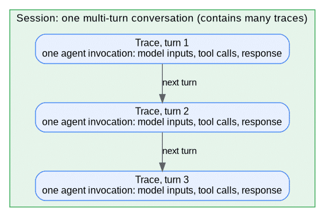
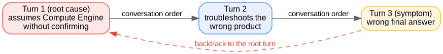

# Telemetry Contract and Trace Debugging

**Module map:** Covers **[4.1]** (prerequisites for evaluable data) and **[4.2]** (OpenTelemetry tracing, Cloud Trace inspection, troubleshooting empty scores and root-turn failures).
**Prerequisites:** [01-quality-flywheel-and-evaluation-modes.md](01-quality-flywheel-and-evaluation-modes.md). **Next:** [03-scenario-generation-and-user-simulator.md](03-scenario-generation-and-user-simulator.md).

---

## 1. Recorded Telemetry as the Evaluation Foundation `[4.1]` `[4.2]`

**What it is:** Every evaluation capability on the Gemini platform—scenario generation, offline evaluation, issue clustering, and online monitoring—reads **recorded telemetry** from Cloud Trace and Cloud Logging rather than intercepting live traffic inline.

**Why it exists:** Decoupling evaluation from live request execution avoids adding latency to user-facing agent responses and creates an immutable audit trail.

### Three One-Time Prerequisites (Per Agent, Not Per Eval)
1. **Agent Runtime with Cloud Trace:** Deploy the agent to **Agent Runtime** with Cloud Trace enabled so spans are recorded where the evaluator can read them.
2. **Cloud Storage Bucket:** Provide a GCS bucket path once to store evaluation outputs (the console pre-fills it on subsequent runs).
3. **Agent Platform SDK Setup (if using SDK):** Configure environment variables, install `gcloud`, and authenticate to your Google Cloud project.

> **Takeaway:** An empty evaluation result (no scores returned) is almost always a **telemetry gap**—not a clean bill of health.

---

## 2. Traces, Spans, and Sessions `[4.2]`

**What it is:** A **span** is a single timed step (such as one model call or one tool call). A **trace** is an immutable chronological record of one agent invocation (a single turn) built from spans. A **session** groups all traces belonging to one multi-turn conversation via `gen_ai.conversation.id`.



| Unit | Scope | When to Evaluate It |
| :--- | :--- | :--- |
| **Trace** | Single agent invocation (one turn) | Target behavior lives in one execution path (e.g., whether a single tool call was correct) |
| **Session** | Entire multi-turn conversation | Target behavior emerges across turns (e.g., context retention or recovering from a wrong assumption) |

> **Takeaway:** Evaluate **traces** for single-turn tool/response checks, and **sessions** when multi-turn context or recovery matters.

---

## 3. The OpenTelemetry Contract `[4.1]` `[4.2]`

**What it is:** The Gemini platform evaluation engine requires specific OpenTelemetry (`gen_ai`) attributes on two telemetry components. The contract is identical for both offline evaluation and online monitoring.

**Silent failure mode:** Missing a required attribute does **not** raise a loud error—it quietly removes the signal a metric needs, producing an **empty score**.

### Required Signals & Attributes

1. **Invoke Agent Span** (identifies the agent and groups turns into sessions):
   - `gen_ai.agent.name`
   - `gen_ai.agent.description`
   - `gen_ai.conversation.id` *(links single traces into a multi-turn session)*

2. **Inference Events (`gen_ai.client.inference.operation.details`)** (observable in **Logs Explorer**):

| Attribute Key | Consumed By |
| :--- | :--- |
| `gen_ai.input.messages` | Response-quality metrics |
| `gen_ai.output.messages` | Response-quality metrics |
| `gen_ai.system_instructions` | Provides system prompt/instruction context to the evaluator |
| `gen_ai.tool.definitions` | Tool-use metrics |

### Environment Variables to Enable Capture
Agents do **not** record message content by default; you must opt in on the deployed agent:

```bash
# 1. Agent Runtime level: send spans to Cloud Trace
GOOGLE_CLOUD_AGENT_ENGINE_ENABLE_TELEMETRY='true'

# 2. ADK content capture (required pair)
OTEL_SEMCONV_STABILITY_OPT_IN='gen_ai_latest_experimental'
OTEL_INSTRUMENTATION_GENAI_CAPTURE_MESSAGE_CONTENT='EVENT_ONLY'
```

- **Console warning note:** The **New experiment** wizard banner displays `OTEL_INSTRUMENTATION_GENAI_CAPTURE_MESSAGE_CONTENT` with shorthand `:true` (warning that tool evaluation fails without it). In actual deployment, pair `OTEL_SEMCONV_STABILITY_OPT_IN='gen_ai_latest_experimental'` with `OTEL_INSTRUMENTATION_GENAI_CAPTURE_MESSAGE_CONTENT='EVENT_ONLY'`.

### Cloud Storage Offload for Multimodal / Large Payloads
Embedding images or large documents directly in trace spans can exceed **span size limits**. For multimodal agents, offload payloads to Cloud Storage so spans store lightweight references while evaluators still read full content (omit these for text-only agents):

```bash
OTEL_INSTRUMENTATION_GENAI_UPLOAD_FORMAT='jsonl'
OTEL_INSTRUMENTATION_GENAI_COMPLETION_HOOK='upload'
OTEL_INSTRUMENTATION_GENAI_UPLOAD_BASE_PATH='gs://STORAGE_BUCKET_NAME/PATH'
```

> **Takeaway:** Always enable `GOOGLE_CLOUD_AGENT_ENGINE_ENABLE_TELEMETRY='true'` plus the `OTEL_SEMCONV_STABILITY_OPT_IN` + `EVENT_ONLY` pair; missing attributes cause silent empty scores.

---

## 4. Reading a Trace to Backtrack to the Root Turn `[4.2]`

**What it is:** The **root turn** is the earliest upstream turn in a session where an unconfirmed assumption or bad decision forced a downstream failure. Backtracking means starting at the failing final answer (the **symptom**) and walking backward turn-by-turn to find the root turn (the **cause**).

**Why it exists:** Scores and rationales summarize a failure, but the trace is the ground truth. Reading turns in order—prompt received, tools called with arguments, response produced—separates a real agent defect from a noisy judge and tells you *what* to fix.



**Worked Example (Wrong-Product Turn on the Google Cloud Support Agent):**
- **Turn 1 (Root Cause):** User says `"my instance is down"`. Agent immediately calls `lookup_resource(type="compute")`—assuming Compute Engine without asking the user to clarify.
- **Turn 2:** Agent calls `get_logs(service="compute")` and returns Compute Engine logs.
- **Turn 3 (Symptom):** Agent answers `"your VM looks healthy, try restarting it"`—wrong, because the resource is actually a Cloud SQL instance.
*Cross-check:* Fixing Turn 3's wording wouldn't solve the bug; backtracking to Turn 1 reveals the actual fix: instruct the agent to disambiguate the product before calling `lookup_resource`.

> **Takeaway:** Never stop at the failing final turn—walk the trace backward to the **root turn** where the agent first made an unconfirmed assumption.

---

## Common Confusions

| Item A | Item B | Key Difference |
| :--- | :--- | :--- |
| **Agent Runtime** | **`GOOGLE_CLOUD_AGENT_ENGINE_ENABLE_TELEMETRY`** | **Agent Runtime** is the current product name; the telemetry env var still uses the legacy `AGENT_ENGINE` namespace. |
| **`:true` banner shorthand** | **`EVENT_ONLY` + `gen_ai_latest_experimental`** | The New experiment banner shows `:true` as shorthand, but deployment requires the two-variable `gen_ai_latest_experimental` + `EVENT_ONLY` pair. |
| **Symptom turn** | **Root turn** | The symptom turn is where the bad final answer appears; the root turn is the earliest upstream turn that caused it. |
| **Empty score** | **Healthy agent** | Empty scores mean missing OpenTelemetry attributes or telemetry off—never assume passing quality from missing scores. |
