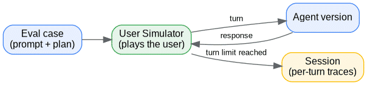

# Scenario Generation and the User Simulator

**Module map:** Covers **[4.1]** (creating test sets—golden data, prompts, edge cases—and bootstrapping evaluation without production traffic).
**Prerequisites:** [02-telemetry-contract-and-trace-debugging.md](02-telemetry-contract-and-trace-debugging.md). **Next:** [04-grading-metrics-and-registry.md](04-grading-metrics-and-registry.md).

---

## 1. Solving the Cold-Start Evaluation Problem `[4.1]`

**What it is:** Newly built agents typically have zero eval cases, no labeled examples, and no live production traffic. **Scenario generation** solves this cold-start gap by automatically synthesizing evaluation cases directly from the agent's own configuration (its **instructions** and **tool definitions**).

**Why it exists:** Writing test cases by hand does not scale, and developers often miss edge cases outside their own mental model. Generating cases from the agent's definition ensures the initial test suite covers the agent's actual capabilities.

### How Scenario Generation Works in the Console
1. In the **New experiment** wizard, select **Simulate sessions** (as opposed to **Traces** or **Sessions**, which grade data you already have).
2. Provide **Generation guidance**—a concise text prompt describing the behaviors and edge cases you want the suite to test.
3. Review the output **table of candidate cases**, where you can edit prompts, adjust plans, or manually add custom edge-case scenarios.
4. Configure **Cloud Storage Location** (GCS bucket URI storing results, prompts, and responses) and optionally toggle **Enable issue clustering** (supported for **Multi-turn Task Success** and **Multi-turn Tool Use Quality**).

> **Takeaway:** Use **Scenario generation** with **Generation guidance** to bootstrap a capability-aligned test suite at day zero before any real traffic exists.

---

## 2. Registered Agent Versions and Eval Case Structure `[4.1]`

### Why a Registered Agent Version Is Required
A simulation requires a fixed target so results are reproducible and comparable across runs. You must have at least one **registered agent version** in the **Agent Registry**, which freezes the agent's **instructions**, **tools**, and **model** into an immutable snapshot. Updating the agent later creates a new version, letting you run A/B comparisons against the exact same eval cases.

### Anatomy of a Generated Eval Case
A generated eval case is a **conversation specification**, not a static transcript:

| Component | Visibility | Role |
| :--- | :--- | :--- |
| **Starting prompt** | Visible | Initial user message sent to start the conversation |
| **Conversation plan** | Hidden | Background instruction guiding how the simulated user behaves and replies across subsequent turns |

> **Takeaway:** An eval case pairs a visible **starting prompt** with a hidden **conversation plan** and runs against an immutable **Agent Registry** snapshot for reproducible A/B comparisons.

---

## 3. The User Simulator and Live Tool Execution `[4.1]`

**What it is:** The **User Simulator** converts a static eval case specification into an active, recorded multi-turn **session** by playing the user role turn-by-turn according to the hidden **conversation plan**.

### Execution Loop & Settings
1. The User Simulator sends the starting prompt, reads the agent's response, and generates follow-up user turns until the conversation resolves or hits the turn cap.
2. The resulting **session** is recorded as sequential **per-turn traces** (capturing model inputs, responses, and tool calls).

| Setting | Purpose | Default / Configurability |
| :--- | :--- | :--- |
| **Max turn** | Prevents infinite loops by capping conversation length | Defaults to **5** (can be increased) |
| **Model name** | Underlying LLM generating the simulated user's turns | Configurable per run |
| **Model configuration** | Hyperparameters/generation settings for the simulator model | Configurable per run |

### Hybrid Architecture & Production Safety Warning
In a simulated run, **only the user side is simulated**. The agent side executes the live **registered agent version**, and **every tool the agent calls actually runs** against its configured backend.

> [!WARNING]
> **No Built-In Tool Sandbox:** The Gemini platform does **not** provide a built-in tool sandbox during simulated runs. Simulated user turns can mutate or impact live production systems if your agent's tools point to production backends.

**Required Isolation Practices (choose one in your own setup):**
1. Run simulations against an **agent version whose tools are safe/read-only** for evaluation.
2. Point the agent's tools at **non-production backends** in the tool configuration.

**Worked Example (Google Cloud Support Agent):**
Suppose you generate an eval case with starting prompt `"My database is slow"` and a hidden conversation plan instructing the simulated user to reveal it is a Cloud SQL instance only if asked.
- The User Simulator drives up to 5 turns (default `Max turn`).
- When the Support agent calls `lookup_resource` or `get_logs`, those tools execute for real—so you must point them to a staging/read-only backend rather than live customer ticket systems.
*Cross-check:* Simulated runs deliver high scoring fidelity because real agent reasoning and real tool outputs are recorded in the session traces.

> **Takeaway:** In a simulated run, only the user is simulated—the agent and its tools execute live with **no built-in sandbox**, so isolate tool backends to non-production or read-only targets.

---

## Common Confusions

| Term A | Term B | Key Difference |
| :--- | :--- | :--- |
| **Simulate sessions** | **Traces / Sessions** (wizard tabs) | **Simulate sessions** creates new synthetic conversations from scratch; **Traces/Sessions** grade already-captured telemetry. |
| **Starting prompt** | **Conversation plan** | Starting prompt is the visible Turn 1 message; conversation plan is the hidden multi-turn instruction for the User Simulator. |
| **User Simulator** | **Tool Sandbox** | User Simulator simulates the *user*; the platform has **no** built-in tool sandbox—tools run live against real backends. |
