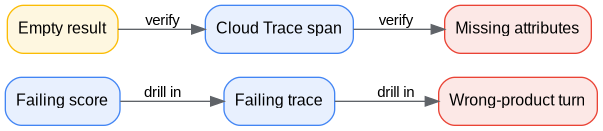

# Offline Evaluation and Result Triage

**Module map:** Covers **[4.1]** (running offline evaluations against traces, sessions, and simulated sessions) and **[4.2]** (triaging failing scores to root turns and troubleshooting empty evaluation results).
**Prerequisites:** [04-grading-metrics-and-registry.md](04-grading-metrics-and-registry.md). **Next:** [06-online-monitoring-and-drift-alerting.md](06-online-monitoring-and-drift-alerting.md).

---

## 1. Bulk vs. Ad-Hoc Offline Evaluation `[4.1]`

**What it is:** **Offline evaluation** grades already-captured interaction data (or freshly simulated sessions). It supports two execution modes: **bulk evaluation** (many traces or sessions at once) and **ad-hoc evaluation** (a single trace or session on demand).

| Dimension | Bulk Evaluation | Ad-Hoc Evaluation |
| :--- | :--- | :--- |
| **Scope** | Many captured traces or sessions simultaneously | Single captured trace or session |
| **When to use** | Measuring quality across an agent **Version** or **time window** | Debugging one suspicious conversation (e.g., where an early wrong assumption compounded across turns) |
| **Console entry point** | `Evaluation` page → **New Experiment** wizard | Agent's `Traces` tab → **Session view** → select conversation → **Evaluation** sub-tab → **Evaluate** |
| **Metrics** | **Four core single-turn metrics** added by default (adjustable) | **Agent Multi-turn Task Success** to surface conversation-level failure |

### Launching a Bulk Evaluation (`New Experiment` Wizard)
1. Open the **Evaluation** page and start **New Experiment**.
2. Choose a data source:
   - **Traces** (existing data: **one turn**) — use when grading single-turn behavior.
   - **Sessions** (existing data: **whole conversation**) — use when grading multi-turn behavior.
   - **Simulate sessions** — use to generate and grade new synthetic conversations.
3. Filter by **Version** or **time window** and select target IDs.
4. Set **`Output private data path`** to a Cloud Storage URI (`gs://...`) for writing results.
5. Review/adjust metrics (4 core single-turn metrics are pre-selected) and run.

> **Takeaway:** Use **Bulk evaluation** (`New Experiment`) to benchmark an agent version or time window, and **Ad-hoc evaluation** (`Traces > Session view > Evaluation`) to grade a single multi-turn conversation on demand.

---

## 2. Triaging Results in the Console `[4.1]` `[4.2]`

**What it is:** A systematic top-down drill-down workflow—from aggregate run scores down to the exact failing turn—so a bulk run of hundreds of cases stays manageable.

### Four-Step Triage Drill-Down
1. **Summary Metrics (Evaluation Report):** Opens with aggregate scores across all eval cases so the weakest dimensions stand out immediately.
2. **Per-Case Results:** Drill into the individual conversations behind a low summary score.
3. **Verdicts and Rationale:** Inspect *why* the case failed:
   - *Adaptive rubric metric* (e.g., `Agent Multi-turn Task Success`): shows passing rate, per-rubric **Pass**/**Fail** verdicts, and natural-language **rationale** from the judge model.
   - *Static rubric metric* (e.g., `Agent Hallucination`, `Safety`): shows a **0-to-1** score plus an **explanation**.
4. **Trace → Root Turn:** Open the underlying trace from the failing row and backtrack turn-by-turn to the earliest turn that caused the failure.

### Troubleshooting Empty Evaluation Results
When an experiment returns **no scores at all**, the cause is almost always **missing telemetry** rather than an engine bug:
1. Open the same trace in **Cloud Trace** and verify the invoke-agent span carries required attributes (`gen_ai.agent.name`, `gen_ai.conversation.id`).
2. Confirm **`Output private data path`** (Cloud Storage URI) is set.
3. Confirm your environment is authenticated before re-running.

**Worked Example (Google Cloud Support Agent):**
An ad-hoc session evaluation on `"my instance is down"` returns a low `Agent Multi-turn Task Success` score, even though each turn's text sounded polite.
- *Cross-check:* Opening the per-case verdicts shows a `Fail` rubric rationale explaining the agent troubleshot Compute Engine instead of Cloud SQL. Drilling into the trace reveals Turn 1 (`lookup_resource(type="compute")`) as the root turn.

> **Takeaway:** Triage from **Summary metrics → Per-case results → Rubric verdicts/rationale → Trace root turn**; if scores are empty, inspect **Cloud Trace** span attributes first.

---

## Common Confusions

| Item A | Item B | Key Difference |
| :--- | :--- | :--- |
| **Traces tab** (New Experiment) | **Sessions tab** (New Experiment) | **Traces** grades single turns; **Sessions** grades entire multi-turn conversations. |
| **Bulk evaluation** | **Ad-hoc evaluation** | Bulk runs via **Evaluation > New Experiment** across many items; ad-hoc runs via **Traces > Session view > Evaluation** on one item. |
| **Empty scores** | **Clean run** | Empty scores indicate missing telemetry (`gen_ai.agent.name`, `gen_ai.conversation.id`), unset GCS path, or auth issues—not 100% pass. |
