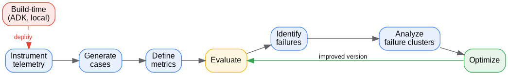

# Failure Clustering, Optimization, and Closing the Flywheel

**Module map:** Covers **[4.1]** (closing the evaluation loop) and **[4.2]** (Automatic Loss Analysis, root-cause diagnosis, optimization, verification re-runs, and end-to-end reference architecture).
**Prerequisites:** [06-online-monitoring-and-drift-alerting.md](06-online-monitoring-and-drift-alerting.md). **Next:** [08-adk-build-time-evaluation.md](08-adk-build-time-evaluation.md).

---

## 1. Automatic Loss Analysis and Failure Clusters `[4.2]`

**What it is:** **Automatic Loss Analysis** analyzes pass/fail signals from **rubric-based metrics**, classifies failures into predefined **loss patterns**, and groups them into semantic **Failure Clusters** (called **loss clusters** in the Python SDK).

**Why it exists:** Raw pass/fail counts don't tell you *how many distinct failure modes* exist or which ones occur most often. Clustering lets you fix a systemic root cause once instead of triaging individual cases one by one.

### How It Runs
- **Console:** Runs **automatically** as part of an evaluation run (no separate launch step) and appears in the **Failure Clusters** section of the report—only when recurring patterns are detected (a clean run shows no clusters). *(Note: In the experiment setup UI, issue clustering is supported for **Multi-turn Task Success** and **Multi-turn Tool Use Quality**.)*
- **Python SDK:** Triggered on demand via `client.evals.generate_loss_clusters`.

### Anatomy of a Failure Cluster
Each cluster displays four elements:
- **Category:** High-level failure type (e.g., `Instruction Following`, `Tool Calling`).
- **Loss Pattern:** The predefined pattern into which the failure is classified.
- **Example Scenarios:** Representative failing cases in the cluster.
- **Rationale:** Explanation of why those grouped cases failed.

### Backtracking a Cluster to the Failing Turn
1. Start at the **lowest-scoring summary metric** (prioritize the weakest metric rather than simply the largest cluster, as it usually points to the highest-impact fix).
2. Drill into **per-case results** (each case retains its cluster category).
3. Inspect rubric **Pass/Fail verdicts** and rationales next to the trace.
4. Trace the conversation backward to the **root turn** where the failure originated.

> **Takeaway:** **Automatic Loss Analysis** groups rubric failures into **Failure Clusters** (`client.evals.generate_loss_clusters` in SDK); start triage from the **lowest-scoring summary metric** and backtrack to the root turn.

---

## 2. Optimizing the Agent and Verifying the Fix `[4.1]` `[4.2]`

### Stage 1: Run Optimization
- **What it modifies:** Typically refines the agent's **system instructions** rather than model weights—so one targeted instruction fix can resolve an entire cluster of related failures.
- **Where it runs:** There is **no console launch button** for optimization. You inspect the failing run in the console to extract the seeding inputs (failing metrics and test cases), then run optimization programmatically via the **SDK and ADK tooling**.

### Stage 2: Verify the Fix via Re-Run
1. Register the optimized agent version in the **Agent Registry**.
2. Re-run the **exact same offline evaluation** and issue clustering over the **original seeded evaluation suite**.
3. Confirm in the report that the targeted **issue cluster shrinks or disappears** while the **task-success metric increases**.

### Strict Verification & Hill-Climbing Rules
- **Reuse the exact same suite:** Never swap in a new or altered suite for verification, or before-and-after scores won't be comparable.
- **Track all metrics together:** Fixing one failure mode can regress another metric; running the full shared suite surfaces trade-offs immediately.
- **Hill-climbing guardrails:** Because the loop (*evaluate → cluster → optimize → re-run*) is **hill climbing**, improvement is not guaranteed on every lap—refinements can **overfit** the eval set or **stall at a local peak**. Treat each lap as a hypothesis validated by a held evaluation suite.

> **Takeaway:** Optimization refines **system instructions** via SDK/ADK (not the console), and must be verified by re-running the **exact same suite** across **all metrics** to catch regressions and overfitting.

---

## 3. End-to-End Gemini Platform Reference Architecture `[4.1]` `[4.2]`

What makes this architecture a **flywheel** rather than a one-way pipeline is the **feedback loop**:
1. **Build-time ADK evaluation** runs locally on your machine before deployment.
2. Once deployed to **Agent Runtime**, you **instrument telemetry**, **generate cases** (Scenario Generation + User Simulator), **define metrics** (Metric Registry), and **evaluate** (offline experiments + online monitors + drift alerts).
3. You **identify failures**, **analyze failure clusters** (Automatic Loss Analysis), and **optimize** instructions.
4. The improved version is added to the **Agent Registry** and submitted back into **evaluation**—closing the Quality Flywheel Lap.

**Worked Example (Google Cloud Support Agent — Closing One Lap):**
After Automatic Loss Analysis clusters failures under `Instruction Following` (wrong-product assumptions on Turn 1), you update the system instructions via SDK/ADK to require product disambiguation before calling `lookup_resource`, register the new version in Agent Registry, and re-run the exact same offline suite.
- *Cross-check:* The `Instruction Following` cluster disappears, `Agent Multi-turn Task Success` rises, and `Safety` / `Agent Hallucination` show no regression.

> **Takeaway:** Define what "good enough" looks like before starting a Quality Flywheel Lap, and close the loop by registering the optimized version in **Agent Registry** and re-evaluating on the same suite.

---

## Common Confusions

| Item A | Item B | Key Difference |
| :--- | :--- | :--- |
| **Automatic Loss Analysis** | **loss clusters** (`client.evals.generate_loss_clusters`) | Same capability: *Automatic Loss Analysis* / *Failure Clusters* in the console; *loss clusters* in the Python SDK. |
| **Largest cluster** | **Lowest-scoring summary metric** | Start triage at the **lowest-scoring summary metric** first, not necessarily the largest cluster. |
| **Console optimization** | **SDK / ADK optimization** | Optimization has **no** console launch button—it runs via SDK/ADK using seeding inputs inspected in the console. |
| **Fresh verification suite** | **Original seeded suite** | Always re-run on the **exact same suite** to compare before/after scores and detect metric regressions. |
