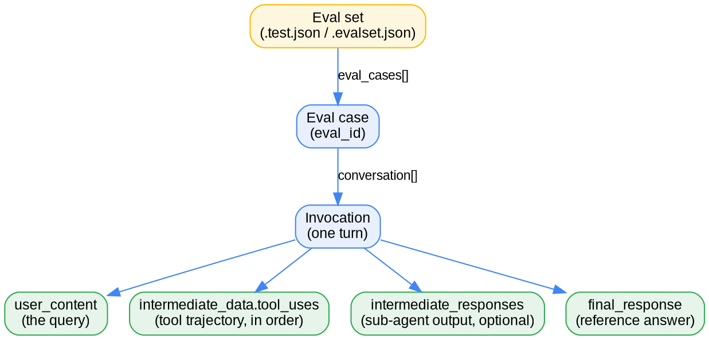
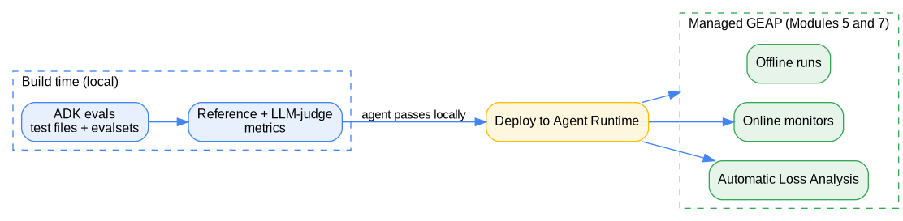

# ADK Build-Time Evaluation and Graduation to Managed Eval

**Module map:** Covers **[4.1]** (ADK evaluation tooling: `*.test.json` vs `*.evalset.json`, `adk web`, `adk eval`, `pytest` `AgentEvaluator`, local reference metrics vs LLM-judge vs Gen AI evaluation service metrics).
**Prerequisites:** [07-failure-clustering-and-optimization.md](07-failure-clustering-and-optimization.md). **Next:** None (end of course).

---

## 1. Build-Time ADK Evaluation vs. Managed Platform Evaluation `[4.1]`

**What it is:** **Agent Development Kit (ADK)** is Google's open-source, code-first framework for building agents. Its built-in evaluation framework runs **locally on your machine** and in **CI/CD pipelines** at build time—before the agent is ever deployed to Agent Runtime.

**Why it exists:** Waiting until cloud deployment to catch regressions slows down the inner development loop. Build-time ADK evaluation catches broken tool trajectories and response regressions as you code, using **Code (`pytest`)**, **CLI (`adk eval`)**, and the **Local ADK Web UI (`adk web`)** instead of the cloud console.

---

## 2. Test Files (`*.test.json`) vs. Evalsets (`*.evalset.json`) `[4.1]`

Both formats share a single **Pydantic data model**, but serve different stages of testing:

| Feature | Test File (`*.test.json`) | Evalset (`*.evalset.json`) |
| :--- | :--- | :--- |
| **Scope** | Holds a **single session** | Holds **multiple, longer multi-turn sessions** |
| **Execution environment** | Runs **locally** as a unit test | Runs against the managed **Gen AI evaluation service** |
| **Billing / cost** | **No billing** (free) | Metered/billed via managed service |
| **Best for** | Fast local checks in the **inner development loop** | **Integration testing** for broader coverage |

### Shared Eval-Case Schema (Pydantic Data Model)


- **Eval Set:** Top-level container holding `eval_cases[]`.
- **`EvalCase` (`eval_id`):** One test scenario containing `conversation[]` (one or more **Invocations**).
- **`Invocation` (`invocation_id`):** One conversational turn containing:
  - `user_content`: Input query (`role: "user"`).
  - `intermediate_data.tool_uses`: Expected **tool trajectory** (tool names and arguments, in order).
  - `intermediate_responses`: Optional sub-agent output.
  - `final_response`: Expected reference answer (`role: "model"`).

### Authoring via `adk web`
Instead of hand-writing JSON, run `adk web <your-agents-dir>`, chat with the agent until it behaves as expected, open the **Eval** tab, and click **Add current session** to save the conversation as an `EvalCase`—then tighten `final_response` or `tool_uses` in the UI or JSON.

> **Takeaway:** Use `*.test.json` for fast, free single-session unit checks in the inner loop and `*.evalset.json` for broader multi-turn integration suites on the Gen AI evaluation service.

---

## 3. Three Ways to Run ADK Evals `[4.1]`

All three entry points invoke the **exact same ADK evaluation engine** and apply the same `test_config.json` criteria:

| Entry Point | Command / API | Best For |
| :--- | :--- | :--- |
| **1. `adk web` UI** | `adk web <your-agents-dir>` | Interactive debugging, threshold sliders, side-by-side **Compare view** (expected vs actual tool trajectory and final response) |
| **2. `adk eval` CLI** | `adk eval path/to/agent path/to/suite.evalset.json --config_file_path=test_config.json` | Scripted runs and **CI/CD pipelines** |
| **3. `pytest` (`AgentEvaluator`)** | `await AgentEvaluator.evaluate(agent_module="support_agent", eval_dataset_file_path_or_dir="tests/support.test.json")` | Automated unit/regression tests inside your standard Python test suite |

- **Handling LLM nondeterminism:** Pass `num_runs` to `AgentEvaluator.evaluate()` to repeat each eval case multiple times and average the score so one unlucky sample does not fail CI.

> **Takeaway:** `adk web`, `adk eval`, and `pytest` (`AgentEvaluator`) all run the same ADK evaluation engine; use `num_runs` to smooth out LLM nondeterminism.

---

## 4. The Three ADK Metric Families `[4.1]`

| Family | Metrics | Where It Runs & Cost | Defaults & Configuration |
| :--- | :--- | :--- | :--- |
| **1. Reference metrics** | `tool_trajectory_avg_score`, `response_match_score` | **On your machine (free, no billing)** | Only metrics with built-in defaults: `tool_trajectory_avg_score` defaults to `1.0` (`EXACT`; also supports `IN_ORDER`, `ANY_ORDER`); `response_match_score` defaults to `0.8` |
| **2. LLM-judge metrics** | `final_response_match_v2`, `rubric_based_final_response_quality_v1`, `rubric_based_tool_use_quality_v1`, `hallucinations_v1` | **On your machine, calling a judge model** | **Must set threshold explicitly.** Configure `judge_model_options` (`judge_model`, e.g., `"gemini-flash-latest"`, and `num_samples`) |
| **3. Multi-turn & safety metrics** | `multi_turn_task_success_v1`, `multi_turn_trajectory_quality_v1` *(UI: Multi Turn Trajectory Quality V1)*, `multi_turn_tool_use_quality_v1`, `safety_v1` | **Gen AI evaluation service** (managed) | **Must set threshold explicitly.** Grades whole multi-turn conversations and safety |

*Indicative `test_config.json` (showing relaxed tool trajectory order and judge options):*
```json
{
  "criteria": {
    "tool_trajectory_avg_score": {"threshold": 1.0, "match_type": "IN_ORDER"},
    "response_match_score": 0.8,
    "final_response_match_v2": {
      "threshold": 0.8,
      "judge_model_options": {"judge_model": "gemini-flash-latest", "num_samples": 5}
    }
  }
}
```

> **Takeaway:** Only `tool_trajectory_avg_score` (`1.0`, `EXACT`) and `response_match_score` (`0.8`) have default thresholds and run free locally; every LLM-judge and Gen AI evaluation service metric requires an explicit threshold.

---

## 5. Graduating from Build-Time ADK to Managed Evaluation `[4.1]`



Build-time evaluation and managed evaluation form one continuous Quality Flywheel:
1. **Build time (local):** Pass `*.test.json` / `*.evalset.json` checks with reference and LLM-judge metrics.
2. **Deploy:** Deploy the ADK agent to **Agent Runtime**.
3. **Managed platform:** Evaluate via the `client.evals` API and console—unlocking **Scenario Generation**, **User Simulator**, **rubric metrics**, **Online Monitors**, and **Automatic Loss Analysis**.

**Worked Example (Google Cloud Support Agent):**
During development, you save a working `VM_instance_wont_start` conversation in `adk web` and run `pytest` with `tool_trajectory_avg_score` (`match_type: "IN_ORDER"`) and `response_match_score` for free on every edit.
- *Cross-check:* Once local tests pass, you deploy to Agent Runtime and graduate to `client.evals` so the User Simulator and Online Monitors test the agent at production scale.

> **Takeaway:** Pass fast, free reference checks locally in ADK first, then deploy to **Agent Runtime** and graduate to `client.evals` for simulation, online monitoring, and Automatic Loss Analysis.

---

## Common Confusions

| Item A | Item B | Key Difference |
| :--- | :--- | :--- |
| **`*.test.json`** | **`*.evalset.json`** | `*.test.json` holds one session and runs locally (free); `*.evalset.json` holds multiple multi-turn sessions and runs on the Gen AI evaluation service. |
| **Reference metrics** | **LLM-judge metrics** | Reference metrics (`tool_trajectory_avg_score`, `response_match_score`) have default thresholds and check exact calls/wording for free; LLM-judge metrics require explicit thresholds and call a judge model for semantic meaning. |
| **`EXACT` vs `IN_ORDER`** | **`ANY_ORDER`** | `EXACT` requires identical tool calls in exact sequence; `IN_ORDER` allows extra calls if expected ones appear in order; `ANY_ORDER` ignores sequence. |
| **`num_runs`** | **`num_samples`** | `num_runs` (in `AgentEvaluator.evaluate`) repeats the **agent** run to handle agent nondeterminism; `num_samples` (in `judge_model_options`) averages multiple **judge model** scores. |
