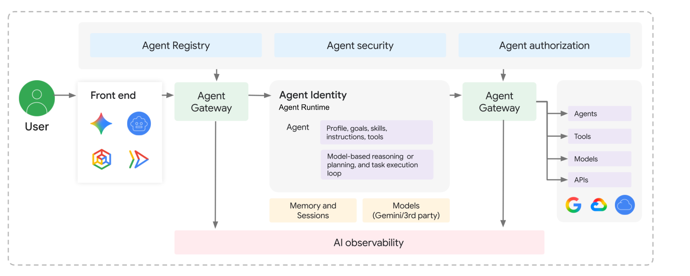
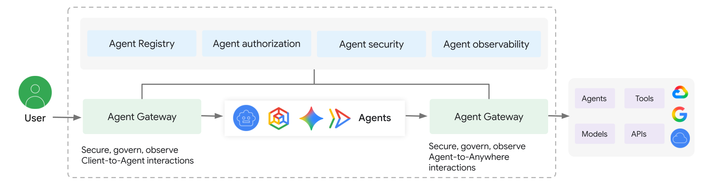
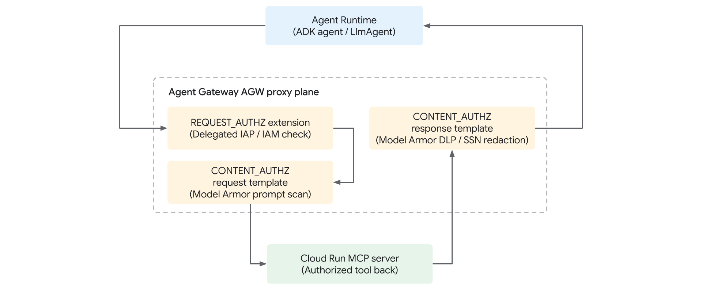

# Centralized Agent Gateway and Dual Access Paths

**Module map:** Why organizations use Agent Gateway as a centralized zero-trust control plane, how it integrates with Agent Registry and IAM, how it separates Client-to-Agent (Ingress) from Agent-to-Anywhere (Egress), and how requests flow through the `REQUEST_AUTHZ` and `CONTENT_AUTHZ` proxy plane. Covers **5.1** (Agent Gateway, Agent Registry), **5.2** (guardrails, secure access), **3.2** (Agent Registry). Prerequisites: none (module entry point). Next: [02-enterprise-networking-and-tool-ingress.md](02-enterprise-networking-and-tool-ingress.md).

---

## 1. Centralized Agent Gateway architecture [5.1][5.2]

**What/why:** As AI agents scale, letting each developer build custom networking and security primitives per agent does not scale and creates inconsistent boundaries. **Agent Gateway** is a centralized networking abstraction and zero-trust control plane that defines communication rules and enforces safety, security, and access control policies without requiring developers to manage low-level networking.

- **Centralized control plane components:**
  - **Agent Registry:** Centralized catalog tracking approved agent workloads and authorized destinations/tools.
  - **Agent Authorization:** IAM and Identity-Aware Proxy (IAP) policies enforced at the gateway.
  - **Agent Security:** Content inspection and sanitization (Model Armor + Cloud DLP).
  - **Agent Observability:** End-to-end tracing and logging (Cloud Trace, Cloud Audit Logs, Cloud Monitoring).
- **Business/operational impact:** Enforces consistent compliance boundaries while compressing agent deployment timelines from weeks to days.



```
         ┌──────────────────────────────────────────────────────────┐
         │  Agent Registry │ Agent Authorization │ Agent Security   │
         └────────┬──────────────────┬────────────────────┬─────────┘
                  │                  │                    │
User ──► Front end ──► [Agent Gateway] ──► Agent Runtime ──► [Agent Gateway] ──► Agents / Tools /
                        (Ingress)         (Agent Identity,     (Egress)          Models / APIs
                                           Memory, Models)
                            │                                      │
                            └──────────────► AI Observability ◄────┘
```

**Takeaway:** Agent Gateway sits on both sides of Agent Runtime—governing inbound user/client calls and outbound agent-to-tool calls from one policy plane.

---

## 2. Dual access paths: Ingress vs. Egress [5.1][5.2]

**What/why:** Securing external clients calling an agent requires different controls than securing an agent calling internal tools. Agent Gateway separates these into two governed access paths:



| Dimension | Client-to-Agent (Ingress) | Agent-to-Anywhere (Egress) |
|---|---|---|
| **Traffic direction** | External clients, developer workspaces, or Gemini web app → Agent Runtime | Agent Runtime → internal tools (MCP servers), Google Cloud APIs, or third-party APIs |
| **Purpose** | Prevent unauthorized invocation, prompt manipulation, and DoS | Control tool calling, prevent data exfiltration, enforce least-privilege data access |
| **Enforcement mechanism** | **Identity-Aware Proxy (IAP)** intercepts connection, validates Google credentials & org role, passes a cryptographically signed **OIDC ID token** to Agent Runtime | Bind Agent Runtime to Agent Gateway via a **regional network attachment**; gateway resolves names via **split-horizon DNS peering** and routes over **Private Service Connect (PSC) Interfaces** |
| **Isolation / allowlist** | Only authenticated, role-authorized enterprise users can invoke the agent | **Zero direct routing to the public internet**; agents can only reach destinations explicitly cataloged in **Agent Registry** |
| **Auditing** | **Cloud Audit Logs** record which enterprise user triggered which Agent Runtime session | Gateway proxy logs, IAP audit logs, Cloud Trace spans |

> [!WARNING]
> **Never allow agents on Agent Runtime to use default public internet egress when handling sensitive enterprise databases.** A prompt-injected or compromised agent can exfiltrate scanned data by writing it to an external public endpoint if egress is not forced through Agent Gateway.

**Takeaway:** Ingress uses IAP + OIDC ID tokens to gate *who* can invoke the agent; Egress uses Network Attachment + DNS peering + PSC + Agent Registry to gate *where* the agent can send data.

---

## 3. Agent Gateway proxy plane: `REQUEST_AUTHZ` and `CONTENT_AUTHZ` [5.1][5.2]

**What/why:** On the egress proxy plane, Agent Gateway inspects both *authorization* (headers/identity) and *content* (prompt/response payloads) using service extensions before traffic reaches or returns from a tool (such as a Cloud Run MCP server).



```
Agent Runtime (ADK agent / LlmAgent)
   │
   ▼  (1) Outbound tool call
┌── Agent Gateway (AGW) Proxy Plane ────────────────────────────────────────┐
│                                                                           │
│  [REQUEST_AUTHZ extension] ──► [CONTENT_AUTHZ request template]           │
│  (Delegated IAP / IAM check     (Model Armor prompt scan)                 │
│   at HTTP header stage)                │                                  │
│                                        ▼                                  │
│                          Cloud Run MCP server (Authorized tool backend)   │
│                                        │                                  │
│                                        ▼                                  │
│                          [CONTENT_AUTHZ response template]                │
│                          (Model Armor DLP / SSN redaction)                │
└────────────────────────────────────────┬──────────────────────────────────┘
                                         │
                                         ▼  (4) Sanitized response
                                   Agent Runtime
```

- **`REQUEST_AUTHZ` (Request authorization):** Evaluated at the **HTTP header stage** *before* the request is forwarded. Integrates with IAP to verify whether the agent's identity holds permissions to call the target endpoint or tool.
- **`CONTENT_AUTHZ` (Content authorization):** Evaluated on the **request and response bodies** using Model Armor templates (prompt injection/RAI checks inbound; DLP/data-leakage checks outbound).

### Worked example: Malicious exfiltration attempt via tool call [5.1][5.2]
*Illustrative scenario:* A user tricks an agent into calling an unapproved external webhook `https://evil.example/exfil` with customer records, or calling an authorized MCP server with a prompt-injected payload.

| Attempt | Gateway control | Outcome | Cross-check |
|---|---|---|---|
| Call unapproved external URL | Agent Registry allowlist + PSC egress (no public internet route) | Blocked at gateway proxy | Egress isolation ✔ |
| Call authorized MCP server without IAM permission | `REQUEST_AUTHZ` (header stage + IAP/IAM) | `403` denied before reaching tool | Header-stage authZ ✔ |
| Call authorized MCP server with SSN in response | `CONTENT_AUTHZ` response template (Model Armor + DLP) | SSN masked before returning to Agent Runtime | Content sanitization ✔ |

**Takeaway:** `REQUEST_AUTHZ` checks *who may call the tool* at the HTTP header stage; `CONTENT_AUTHZ` checks *what is in the payload* before and after tool execution.

---

## Common confusions

| Looks like | Difference |
|---|---|
| **Ingress vs. Egress in Agent Gateway** | Ingress = Client-to-Agent (IAP + OIDC ID token); Egress = Agent-to-Anywhere (Network Attachment + DNS peering + PSC + Agent Registry) |
| **`REQUEST_AUTHZ` vs. `CONTENT_AUTHZ`** | `REQUEST_AUTHZ` inspects HTTP headers/identity for IAM/IAP authorization; `CONTENT_AUTHZ` inspects request/response bodies via Model Armor & DLP |
| **Agent Gateway vs. Agent Registry** | Agent Gateway is the traffic/policy enforcement proxy; Agent Registry is the catalog of approved agents and tool destinations that the gateway enforces |
| **Default Agent Runtime egress vs. Governed egress** | Default egress routes over the public internet (exfiltration risk); governed egress binds via regional network attachment to Agent Gateway |

Sources: `sources/centralized-agent-governance-raw.md`, `sources/Deployment modes.png`, `sources/centralized gateway archit.svg`, `sources/The centralized gateway ar.png`.
