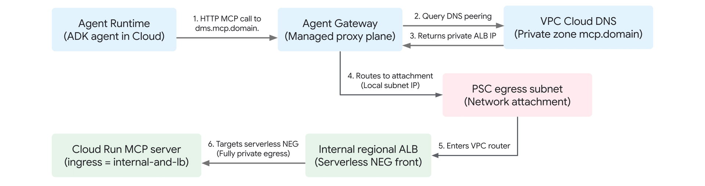

# Enterprise Networking, Private Egress, and Tool Ingress

**Module map:** How to provision VPC subnets for Agent Gateway, how private egress works using Network Attachments (PSC Interfaces) and split-horizon DNS peering, and how to choose between Default (Public) and Secure (Private) ingress for Cloud Run MCP servers. Covers **5.1**, **5.2** (Agent Gateway networking & isolation), **4.2** (deployment topology). Prerequisite: [01-centralized-gateway-and-dual-paths.md](01-centralized-gateway-and-dual-paths.md). Next: [03-identity-access-control-and-guardrails.md](03-identity-access-control-and-guardrails.md).

---

## 1. VPC subnet architecture (automated with Terraform) [5.1][5.2]

**What/why:** Deploying Agent Gateway with private enterprise connectivity requires separating workloads, load balancer proxies, and gateway egress into non-overlapping subnets, typically automated via Terraform.

| Component | CIDR / Sizing | Purpose |
|---|---|---|
| **Primary Subnet** | Standard regional subnet | Runs standard internal services inside the VPC |
| **Proxy Only Subnet** | `/24` active range | Required by Google Cloud's regional Application Load Balancer (ALB) |
| **Agent Gateway Subnet** | Dedicated `/28` or larger (RFC 1918, e.g., `10.0.0.0/24`) | Reserved exclusively for Agent Gateway egress; **must not overlap** with standard VPC routing |
| **Cloud NAT + Cloud Router** | Attached to private subnets | Lets resources in private subnets pull software updates without exposing them to inbound internet traffic |

**Takeaway:** Agent Gateway requires its own non-overlapping `/28`+ RFC 1918 egress subnet, separate from the primary subnet and the `/24` proxy-only subnet used by regional ALBs.

---

## 2. Private egress primitives: Network Attachment, PSC, and DNS peering [5.1][5.2]

**What/why:** When an agent on Agent Runtime calls an internal tool, traffic must enter your VPC privately without traversing the public internet. Two primitives make this work:

- **Network Attachment (PSC Interface):** A regional VPC resource (e.g., `agent-gateway-na`) representing the physical endpoint where Agent Gateway egress traffic enters your VPC. It pulls private IPs from the dedicated Agent Gateway egress subnet so calls to internal tools appear to originate from local VPC subnet IPs.
- **Split-Horizon DNS Peering:** Dedicated DNS resolution allowing Agent Gateway to query your VPC's private Cloud DNS zone (e.g., `mcp.domain`) to resolve internal tool hostnames to private ALB IPs.

### 6-step private egress & DNS resolution flow



```
Agent Runtime (ADK agent)
  │  1. HTTP MCP call to dms.mcp.domain
  ▼
Agent Gateway (Managed proxy plane) ── 2. Query DNS peering ──► VPC Cloud DNS
  │                                 ◄── 3. Private ALB IP  ──   (Private zone mcp.domain)
  │  4. Routes to Network Attachment (local subnet IP)
  ▼
PSC egress subnet (Network attachment)
  │  5. Enters VPC router
  ▼
Internal regional ALB (Serverless NEG front)
  │  6. Targets serverless NEG (fully private egress)
  ▼
Cloud Run MCP server (ingress = internal-and-cloud-load-balancing)
```

**Takeaway:** Agent Gateway resolves private tool hostnames via Cloud DNS peering, then injects traffic into your VPC through a regional Network Attachment (PSC Interface) using local egress-subnet IPs.

---

## 3. Flexible tool ingress: Public vs. Private Cloud Run MCP servers [5.1][5.2][4.2]

**What/why:** Internal tools (MCP servers) hosted on Cloud Run support two ingress topologies. Choosing the wrong one either violates strict corporate compliance rules (no public URLs) or slows down early development with unnecessary DNS/SSL overhead.

| Feature | Default: Public Ingress | Secure: Private Ingress |
|---|---|---|
| **Cloud Run ingress setting** | `ingress = "all"` | `ingress = "internal-and-cloud-load-balancing"` |
| **Hostname type** | Public `*.run.app` | Private `*.mcp.your-domain.com` |
| **Traffic routing** | Agent Gateway → standard HTTPS → `*.run.app` | Agent Gateway → PSC Network Attachment → Internal regional ALB + Serverless NEG → Cloud Run |
| **SSL certificate** | Automatic (Google-managed) | Regional Google-managed (**requires owning a public DNS domain delegated to Cloud DNS** for DNS validation) |
| **External visibility** | Public URL exists (unauthenticated internet requests fail; secured by IAM, IAP, and Agent Gateway service extensions) | Completely hidden (`*.run.app` disabled; unreachable from outside the VPC) |
| **Best used for** | Sandbox development, rapid proof-of-concept (no custom domain needed) | Production workloads with strict compliance rules forbidding public endpoints |

### Worked example: Choosing an ingress topology [4.2][5.1]
*Scenario (*illustrative*):*
- **Case A:** A platform team is prototyping a new MCP server for 5 developers in a sandbox project and has not yet delegated a corporate subdomain to Cloud DNS.
  - *Choice:* **Public ingress (`ingress = "all"`)**. Fast setup, automatic Google-managed SSL, still protected by IAP/IAM and Agent Gateway service extensions ✔.
- **Case B:** A regulated financial enterprise requires zero public endpoints for its internal customer-data MCP server and already owns `mcp.corp.example` in Cloud DNS.
  - *Choice:* **Private ingress (`ingress = "internal-and-cloud-load-balancing"`)** behind an internal regional ALB + Serverless NEG. Completely unreachable from the internet ✔.

**Takeaway:** Use `ingress = "all"` (secured by IAP/IAM) for rapid dev/POC; use `ingress = "internal-and-cloud-load-balancing"` + Internal ALB + Serverless NEG when policy forbids any public endpoint.

---

## Common confusions

| Looks like | Difference |
|---|---|
| **Proxy-only subnet vs. Agent Gateway subnet** | Proxy-only (`/24`) is required by the regional ALB; Agent Gateway subnet (`/28`+) is where the Network Attachment pulls private egress IPs |
| **Public Cloud Run ingress = unauthenticated?** | No — even with `ingress = "all"`, IAP, IAM, and Agent Gateway service extensions block unauthenticated internet requests; it only fails compliance rules that forbid *any* public endpoint |
| **Cloud NAT vs. Network Attachment** | Cloud NAT lets private VPC resources pull outbound software updates; Network Attachment lets Agent Gateway push egress MCP calls *into* the VPC |

Sources: `sources/infrastructure-and-enterprise-networking-raw.md`, `sources/DNS peering and resolution.png`.
