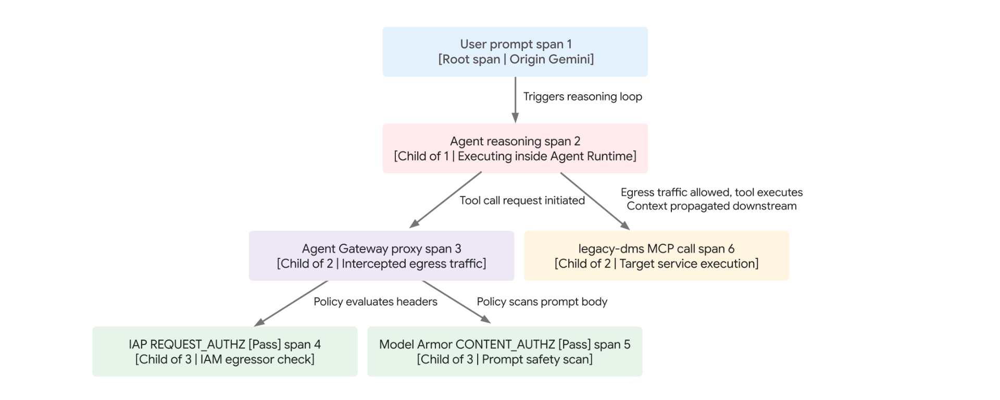
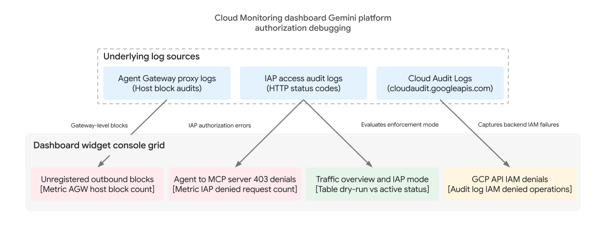

# Observability, Tracing, Auditing, and Rollout Governance

**Module map:** How to audit multi-step agent execution with OpenTelemetry and Cloud Trace, how Access Transparency (AxT) logs vendor support access, how the Cloud Monitoring Authorization Debugging Dashboard diagnoses denials, and how to safely roll out IAP enforcement using `DRY_RUN`. Covers **4.2** (monitoring, tracing, troubleshooting), **5.1** (tracking, governance, debugging), **5.2** (auditing). Prerequisite: [03-identity-access-control-and-guardrails.md](03-identity-access-control-and-guardrails.md).

---

## 1. End-to-end auditing with OpenTelemetry and Cloud Trace [4.2][5.1]

**What/why:** A single agent task can loop across multiple reasoning steps, databases, and security extensions, making plain text logs hard to correlate. Because the Gemini platform is **natively instrumented with OpenTelemetry**, it automatically emits **tracing spans** across every operational layer, visualized as a **hierarchical waterfall chart** in the Google Cloud Console **Traces** dashboard.

### 6-span execution hierarchy



```
Span 1: User prompt [Root span | Origin: Gemini Enterprise]
   │  Triggers reasoning loop
   ▼
Span 2: Agent reasoning [Child of 1 | Executing inside Agent Runtime]
   ├── Tool call request initiated ──► Span 3: Agent Gateway proxy [Child of 2 | Intercepted egress]
   │                                      ├── Policy evaluates headers ──► Span 4: IAP REQUEST_AUTHZ [Pass] (IAM egressor check)
   │                                      └── Policy scans prompt body ──► Span 5: Model Armor CONTENT_AUTHZ [Pass] (Prompt safety scan)
   └── Egress allowed, context propagated ──► Span 6: Target MCP call (e.g., legacy-dms) [Child of 2 | Target execution]
```

### Traces dashboard investigation tabs
- **`VISUAL TIMELINE`:** Hierarchical waterfall chart showing exact duration per span to pinpoint latency spikes.
- **`POLICY INSPECTION`:** Inspects authorization policy decisions (e.g., `REQUEST_AUTHZ` pass/fail).
- **`CONTENT SAFE-AUDIT`:** Inspects content safety scan results (e.g., `CONTENT_AUTHZ` / Model Armor).

> [!TIP]
> **Best practice:** Always keep OpenTelemetry tracing active in production runtimes. Latency overhead is negligible (**less than a few milliseconds**), while complete visual execution records are essential for compliance and debugging.

**Takeaway:** Native OpenTelemetry spans trace every hop—from user prompt through Agent Runtime, `REQUEST_AUTHZ`, `CONTENT_AUTHZ`, and the target MCP server—into one Cloud Trace waterfall.

---

## 2. Accountability: Access Transparency (AxT) [5.1][5.2]

**What/why:** Regulated environments require an audit trail of *every* entity touching sensitive data, including vendor support engineers. **Access Transparency (AxT)** provides cryptographic, auditable logs showing when and why Google Cloud personnel access your configurations or agent databases (e.g., during a support ticket).

- **Compliance:** Helps satisfy regulatory frameworks such as **HIPAA, FedRAMP, and GDPR** that require audit trails for vendor support actions.
- **Scope:** Covers the entire agent ecosystem—logging accesses to **VPCs, reasoning engines, gateways, and Model Armor configurations**.

**Takeaway:** Access Transparency gives cryptographic proof of when and why Google Cloud personnel accessed your agent VPCs, gateways, reasoning engines, or Model Armor configs.

---

## 3. Authorization Debugging Dashboard & safe IAP rollout (`DRY_RUN` → `null`) [4.2][5.1]

**What/why:** Enforcing strict IAP/IAM policies on egress traffic from day one can break legitimate tool calls if policies are misconfigured. You combine a custom **Authorization Debugging Dashboard** in Cloud Monitoring with a phased IAP enforcement mode.

### Dashboard log sources and widgets



| Underlying log source | Signal captured | Dashboard widget |
|---|---|---|
| **Agent Gateway proxy logs** (Host block audits) | Gateway-level blocks | **Unregistered outbound blocks** (`Metric AGW host block count`) |
| **IAP access audit logs** (HTTP status codes) | IAP authorization errors | **Agent to MCP server 403 denials** (`Metric IAP denied request count`) |
| **IAP access audit logs** (HTTP status codes) | Evaluates enforcement mode | **Traffic overview and IAP mode** (`Table dry-run vs active status`) |
| **Cloud Audit Logs** (`cloudaudit.googleapis.com`) | Backend IAM failures | **GCP API IAM denials** (`Audit log IAM denied operations`) |

### Safe rollout workflow (best practice)
1. Deploy Agent Gateway with IAP Enforcement set to **`DRY_RUN`** during initial testing.
2. Validate that the agent discovers and calls its tools while monitoring the **Authorization Debugging Dashboard** to confirm IAM policies are built without operational disruption.
3. Once you confirm **zero false positives** in the logs, update IAP Enforcement mode to **`null`** to actively enforce policies.

### Worked example: Diagnosing a blocked tool call [4.2][5.1]
*Scenario (*illustrative*):* An agent fails to reach a new Cloud Run MCP server after deployment.
1. Check **Unregistered outbound blocks**: count is `0` → the host *is* in Agent Registry ✔.
2. Check **Agent to MCP server 403 denials**: spike in `403`s → IAP/`REQUEST_AUTHZ` denied the agent's identity ✔.
3. Open **Cloud Trace → `POLICY INSPECTION`** to confirm the exact span (`Span 4: IAP REQUEST_AUTHZ`) that failed, then grant the missing role on the agent's service account (testing in `DRY_RUN` before switching back to `null`) ✔.

**Takeaway:** Start Agent Gateway IAP enforcement in `DRY_RUN`, verify zero false positives across the 4-widget Authorization Debugging Dashboard, then switch to `null` to enforce.

---

## 4. Uncaptured course lessons (Gaps)

> [!NOTE]
> **Gap [3.2][3.3][5.1]:** Two lesson pages in the syllabus were not retained in the raw capture:
> 1. **Runtime tool discovery (Agent Registry):** Covered in concept across [01-centralized-gateway-and-dual-paths.md](01-centralized-gateway-and-dual-paths.md) (allowlist of approved agents/tools), but runtime discovery mechanics/APIs were not captured.
> 2. **Agent threat detection (Security Command Center):** Referenced in the syllabus, but the lesson body was not captured.
> Review both topics in official Google Cloud docs if needed for 5.1/3.2.

---

## Common confusions

| Looks like | Difference |
|---|---|
| **Cloud Trace vs. Cloud Audit Logs** | Cloud Trace (`Traces`) shows per-request latency & span hierarchy (including `REQUEST_AUTHZ` and `CONTENT_AUTHZ`); Cloud Audit Logs capture control-plane/IAM access events |
| **Access Transparency (AxT) vs. Cloud Audit Logs** | Cloud Audit Logs record *your* users' and agents' actions; AxT records *Google Cloud personnel* accessing your tenant resources |
| **IAP `DRY_RUN` vs. `null`** | `DRY_RUN` logs policy evaluations without blocking traffic; `null` actively enforces IAP policies |
| **AGW host block vs. IAP 403 denial** | Host block = destination not cataloged in Agent Registry; IAP 403 = destination is registered, but the agent's identity lacks permission |

Sources: `sources/discovery-and-observability-raw.md`, `sources/monitoring-and-governance-raw.md`, `sources/Gemini @work updates_image-1.svg`, `sources/Gemini @work updates_image.svg`.
