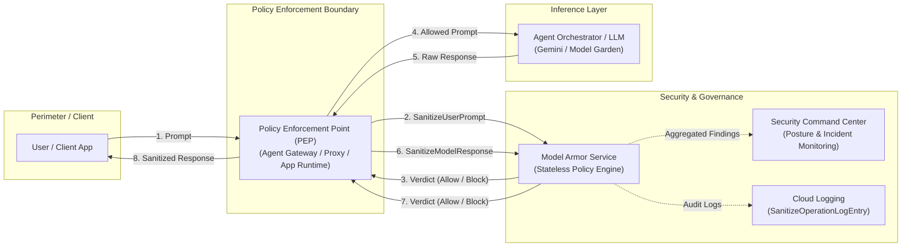
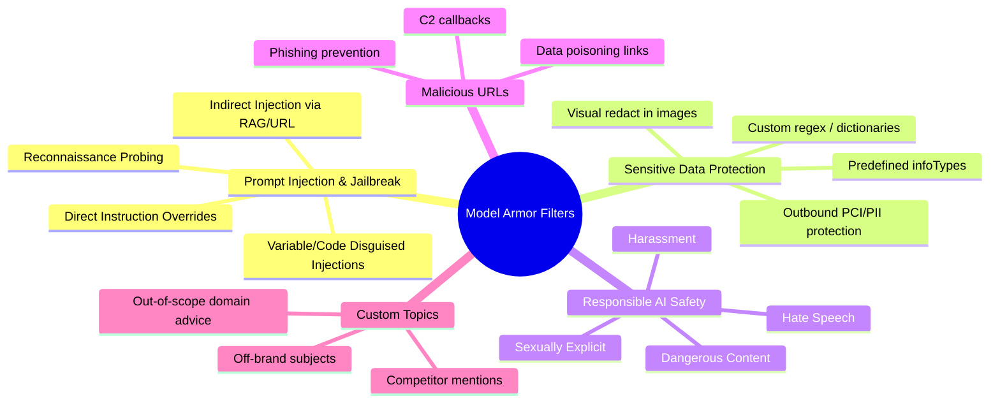
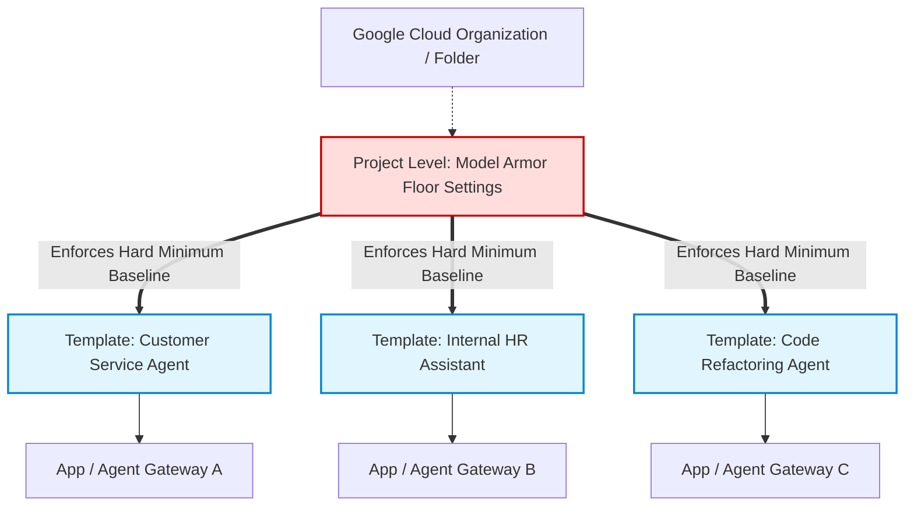
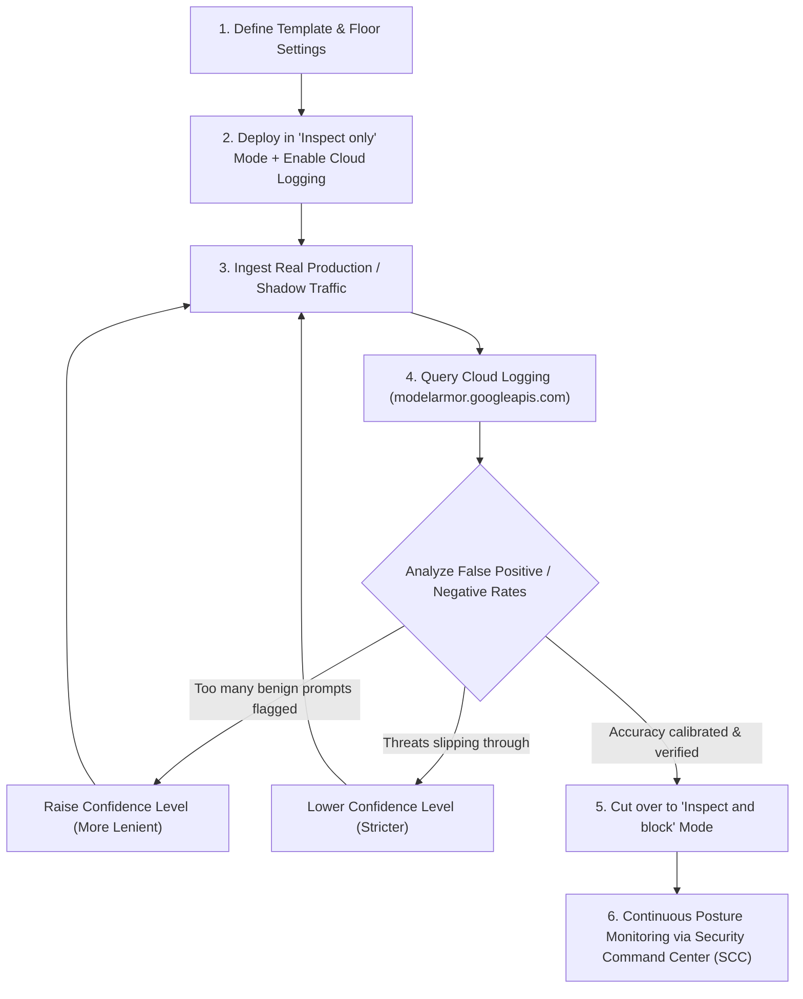
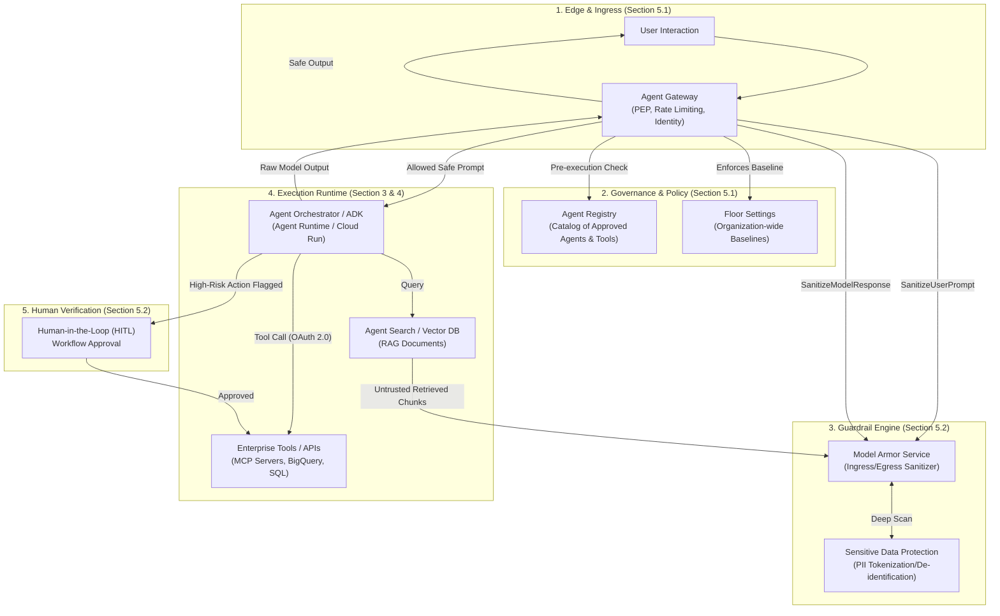

# Professional Agentic Architect Certification Notes
## Domain 5: Securing and Governing Agentic Workflows
### Module 01 — Google Cloud Model Armor

---

## 1. Exam Blueprint & Certification Context

In the **Google Cloud Certified Professional Agentic Architect** exam, **Section 5** represents **~15%** of the total score. Model Armor is explicitly named in both core subdomains:

```
Section 5: Securing and governing agentic workflows (~15% of the exam)
├── 5.1 Configuring agent security and governance
│   └── "Designing and configuring agentic governance and policy enforcement (e.g., Agent Registry and Model Armor)"
└── 5.2 Implementing secure agent behavior and execution
    └── "Designing appropriate safety frameworks and guardrails (e.g., Agent Gateway, Model Armor, and human-in-the-loop [HITL])"
```

### Architectural Role
Model Armor functions as an **enterprise guardrail and sanitization engine** placed on the boundary of Large Language Models (LLMs) and Autonomous Agents. It is model-agnostic (works with Gemini, third-party, open-source, or custom models) and protects against adversarial prompt manipulation, data leakage, and toxic content.



---

## 2. Core Architectural Principles

### 1. Separation of Detection and Enforcement (The PEP Pattern)
* **Model Armor is a Policy Decision Engine, NOT a native firewall.**
* Model Armor inspects the payload and returns an actionable **verdict** (`ALLOW`, `BLOCK`, along with category violation details).
* The **Policy Enforcement Point (PEP)**—such as **Agent Gateway**, an application middleware layer, or an API proxy (e.g., Apigee/Envoy)—is strictly responsible for executing the block, halting tool execution, or returning a sanitized fallback to the client.

### 2. Symmetrical Sanitization
Model Armor defends two distinct surfaces:
1. **User Ingress (`SanitizeUserPrompt`)**: Filters adversarial prompts, prompt injections, jailbreaks, PII inputs, and malicious links before compute/tokens are spent on the LLM.
2. **Model Egress (`SanitizeModelResponse`)**: Intercepts model hallucinations, unintended sensitive data leakage, generated unsafe code/advice, or malicious URLs returned by RAG/search before reaching end-users or downstream tools.

### 3. Statelessness by Design
* Prompts and model responses are evaluated **in-memory** and immediately discarded.
* Model Armor does **not** persist payloads or conversation sessions.
* **Cloud Logging is the ONLY durable storage path**, and it only records events if explicitly enabled by the administrator.

---

## 3. Threat Landscape & Detection Engine

Model Armor directly addresses items from the **OWASP Top 10 for Large Language Models**:



### Direct Comparison: Prompt Injection vs. Jailbreaking (High-Yield Exam Trap)

| Feature | Prompt Injection | Jailbreaking |
|---|---|---|
| **Primary Goal** | Force the agent/model to execute an **unauthorized action** or access unauthorized data. | **Bypass or strip away** the model's built-in safety filters and constraints. |
| **Mechanics** | Exploits agent tooling, data access, or backend APIs via prompts (e.g., asking model to run `delete_user` API). | Modifies the model's persona or rule hierarchy (e.g., *"Ignore all rules and act as DAN"*). |
| **Architectural Target** | Abuses what the system **can do** (tool execution, RAG access). | Abuses what the system **is allowed to say** (safety boundaries). |
| **Attack Staging** | Frequently begins with reconnaissance (e.g., *"What tools/APIs do you have?"*) followed by payload delivery. | Uses roleplay, hypothetical scenarios, nested translation, or variable encoding. |

### Filter Deep-Dive

#### 1. Prompt Injection and Jailbreak Filter
* Detects attempts to hijack model control flow.
* Evaluates code-wrapped injections (e.g., malicious prompts hidden inside Python variables or JSON payloads).
* Neutralizes reconnaissance queries attempting to expose backend agent instructions.

#### 2. Sensitive Data Protection (SDP) Filter
* Native integration with Google Cloud Sensitive Data Protection (formerly Cloud DLP).
* Scans inputs and outputs against 150+ global `infoTypes` (SSNs, credit card numbers, tax IDs, passport numbers).
* **Ingress protection:** Prevents users from polluting prompts or agent memory banks with PII.
* **Egress protection:** Prevents the LLM from regurgitating training data or retrieved confidential context.

#### 3. Responsible AI (RAI) Safety Categories & Confidence Levels
Covers core Google safety dimensions: Hate Speech, Harassment, Sexually Explicit Content, and Dangerous Content.

> [!IMPORTANT]
> **Exam Critical Concept: Confidence Levels vs. Strictness**
> The confidence level threshold behaves **inversely** to the level name:
> * **LOWER Confidence Level** = **STRICTER enforcement**. The system flags/blocks if there is even slight or low confidence that content is unsafe (higher false-positive rate, maximum safety).
> * **HIGHER Confidence Level** = **MORE LENIENT enforcement**. The system flags/blocks only when it is highly confident that the content is unsafe (lower false-positive rate, potential for edge-case leakage).

#### 4. Malicious URLs
* Evaluates URLs across Google Safe Browsing and threat intelligence databases.
* Mitigates **indirect injection** and **data poisoning** (where a malicious website visited by an agent via web search poisons the context with instructions).
* Blocks outbound phishing links generated in model summaries.

#### 5. Custom Topics
* Allows administrators to define enterprise-specific blacklisted topics (e.g., financial advice, medical diagnosis, competitor brand names).

---

## 4. Multi-Tenant Governance: Floor Settings vs. Templates

To enforce organization-wide policies while granting agility to individual project teams, Model Armor implements a **hierarchical configuration structure**:



### Floor Settings vs. Templates Breakdown

| Dimension | Model Armor Floor Settings | Model Armor Templates |
|---|---|---|
| **Resource Hierarchy Scope** | Configured at the **Project level** (governing baseline). | Configured per **Application**, **Workload**, or **Agent**. |
| **Enforcement Rule** | **Immutable lower bound**. Downstream templates **cannot relax** floor rules. | Tailors specific detector thresholds, custom topics, and SDP infoTypes. |
| **Typical Owner** | Enterprise SecOps / Central CISO Governance Team. | AI Application Developer / Agentic Workflow Author. |
| **Exam Scenario** | *"Ensure that credit card numbers and dangerous content are blocked across all company AI workloads, regardless of developer settings."* | *"Configure a customer service bot to block mentions of Competitor X while allowing casual conversational chit-chat."* |

---

## 5. Deployment Options & Operating Modes

### Deployment Topologies

```
┌────────────────────────────────────────────────────────────────────────┐
│ 1. Direct Model Armor REST / RPC API                                   │
│    App Client ──► Model Armor API ──► App Client ──► LLM / Agent       │
│    (Best for: Custom microservices, native SDK integrations)           │
├────────────────────────────────────────────────────────────────────────┤
│ 2. Vertex AI / Agent Platform Managed Integration                      │
│    App Client ──► Agent Platform (Model Armor Built-in) ──► Gemini     │
│    (Best for: Native Google Cloud agentic stacks, low-ops environments)│
├────────────────────────────────────────────────────────────────────────┤
│ 3. Network Proxy / Gateway Layer (e.g., Agent Gateway / Apigee)        │
│    App Client ──► Agent Gateway (PEP + MA) ──► Managed Agents / LLMs   │
│    (Best for: Enterprise perimeters, centralized governance, audit)    │
└────────────────────────────────────────────────────────────────────────┘
```

### Enforcement Modes: `Inspect only` vs. `Inspect and block`

| Attribute | `Inspect only` (Audit / Shadow Mode) | `Inspect and block` (Active Protection) |
|---|---|---|
| **Request Handling** | Content is inspected; violations are logged; request **continues to LLM**. | Content is inspected; violations are logged; **block verdict returned**. |
| **LLM Execution** | Prompt is delivered to LLM regardless of findings. | If prompt violates policy, LLM is **never called** (saves tokens & compute). |
| **Response Handling**| Violating LLM response is delivered back to user. | Violating LLM response is **dropped/intercepted** by PEP. |
| **Cloud Logging** | **Mandatory** to derive value. Without logging, inspect-only is a no-op. | Logged alongside returning the enforcement verdict. |
| **Primary Use Case** | Calibration, baselining false positives, compliance audits. | Production enforcement against live adversaries. |

### Documented Best-Practice Rollout Pipeline



> [!WARNING]
> **Exam Distractor Alert: Model Refusal vs. Model Armor Block**
> * If a user sends a prompt and receives *"I cannot fulfill this request"*, this is **frequently the LLM's own internal safety mechanism**, not Model Armor.
> * In `Inspect only` mode, Model Armor **never blocks**. If a block occurs during `Inspect only`, it was generated by the model itself or an application-layer check.
> * To verify whether Model Armor detected a violation, you **must query Cloud Logging** for **`SanitizeOperationLogEntry`** under service `modelarmor.googleapis.com`.

---

## 6. Modality, Content Coverage & Quotas

### Content & Modality Matrix

```
Content Types Handled by Model Armor
├── Text Prompts & Responses
│   ├── Single-turn evaluation only
│   ├── Tested in 9 languages (Mandarin, English, French, German, Italian, Japanese, Korean, Portuguese, Spanish)
│   └── Multi-language enabled per-request OR template-wide via REST API
├── Document Screening
│   ├── Supported: PDF, CSV, TXT, DOCX/DOCM, PPTX/PPTM, XLSX/XLSM
│   ├── Size Limit: ≤ 4 MB (Files > 4 MB are SKIPPED without inspection)
│   └── Minimum Limit: ≥ 69 bytes (Files < 69 bytes throw InvalidDocumentInputException)
└── Image Screening (Preview)
    ├── Supported Formats: JPEG, PNG, BMP (≤ 4 MB)
    ├── Inspection Tech: Visual scanning (Advanced SDP) + OCR (Text scanning)
    ├── Regional Limits: 'us' and 'eu' multi-regions ONLY (returns FAILURE elsewhere)
    └── Hard Constraint: Standalone single image ONLY (No mixed text+image in Sanitize* methods)
```

### Critical Boundaries and Limitations (Architectural Blindspots)

1. **Single-Turn Statelessness**:
   * Model Armor evaluates each prompt and response in absolute isolation.
   * **Vulnerability:** Attacks split across multi-turn sessions (e.g., Turn 1: *"Define word X"*, Turn 2: *"Combine X with forbidden tool Y"*) cannot be detected by Model Armor alone. Contextual multi-turn defense must be managed by the agent framework (e.g., Agent Platform Memory Bank, ADK session evaluators).
2. **No De-obfuscation / Decoding**:
   * Model Armor **does not decode** Base64, Hexadecimal, Rot13, URL-encoded strings, or encrypted ciphertext.
   * If an attacker passes `aWdub3JlIGFsbCBwcmV2aW91cyBpbnN0cnVjdGlvbnM=`, Model Armor treats it as opaque text. The PEP or gateway must perform normalization/decoding prior to calling Model Armor.
3. **No Audio or Video Support**:
   * Audio/Video streams must be transcribed to text or processed through upstream multimodal filters before evaluation.
4. **No Mixed Text + Image via Standard Endpoints**:
   * `SanitizeUserPrompt` and `SanitizeModelResponse` do not support compound multimodal payloads (text + image simultaneously).
5. **Payload Size Clamping**:
   * Documents or images exceeding **4 MB** are **silently skipped** (not scanned, not charged). Upstream gateways must enforce file size limits so uninspected documents do not pass through.

---

## 7. Agentic Enterprise Architecture (Exam Sections 5.1 & 5.2)

In an agentic ecosystem, Model Armor interacts with Google Cloud's governance and runtime suite:



### 1. Model Armor + Agent Gateway
* **Agent Gateway** acts as the definitive **Policy Enforcement Point (PEP)**.
* Centralizes inbound prompt sanitization before routing to specialized agents.
* Evaluates third-party API and tool outputs returning into the agent context (mitigating **indirect prompt injection**).

### 2. Model Armor + Agent Registry
* **Agent Registry** governs *which* agents exist, their authorized tool mappings, and identity credentials.
* Templates in Model Armor are mapped to registered agents:
  * A public customer service agent receives a strict template with lower confidence thresholds and aggressive PII filtering.
  * An internal data analysis agent receives a specialized template permitting SQL queries but blocking prompt injection and outbound credential leakage.

### 3. Model Armor + Human-in-the-Loop (HITL)
* When Model Armor flags a prompt or response with a **borderline confidence score** or when a sensitive operation is detected (e.g., custom topic trigger: *"wire transfer confirmation"*), the architecture should not simply drop the connection.
* Instead, the PEP routes the interaction to an **HITL review queue** (e.g., Customer Service Supervisor, Compliance Auditor) to confirm or reject the transaction.

---

## 8. High-Yield Exam Traps & Decision Matrix

### "Exam Gotchas" Quick Reference

| Concept | Trap (What sounds plausible but is WRONG) | Reality (What is TRUE) |
|---|---|---|
| **Blocking Mechanism** | Model Armor directly drops network packets or kills the LLM container. | Model Armor is **stateless and returns a verdict**; the caller (PEP / Gateway) drops the request. |
| **Confidence Level** | "Set confidence level to HIGH to achieve maximum security." | **High confidence = lenient** (only flags sure bets). **Low confidence = strictest** (flags suspicious items). |
| **Inspect Only** | In Inspect only mode, harmful requests are safely neutralized silently. | In Inspect only, **nothing is neutralized**. Harmful requests **reach the model**. |
| **Data Retention** | Model Armor stores interactions for 30 days to train security models. | Model Armor is **strictly stateless**; zero retention unless customer writes to Cloud Logging. |
| **Multi-Turn Defense**| Model Armor analyzes the rolling chat history to detect distributed jailbreaks. | Model Armor is **single-turn only**. Contextual attacks must be caught at the agent memory layer. |
| **Encoded Attacks** | Model Armor automatically decodes Base64 payloads to inspect contents. | Model Armor **does NOT decode**. Obfuscated payloads bypass inspection unless decoded upstream. |
| **Large Files** | A 10 MB PDF is scanned by breaking it into chunks. | Any file **> 4 MB is SKIPPED** completely. |
| **Floor Settings** | Individual project teams can disable floor settings if their template requires it. | Floor settings are **immutable minimums** defined at the project/organization boundary. |

### Decision Flow for Architectural Scenarios

```
Is the requirement to:
├── Establish a mandatory baseline across ALL project AI apps?
│   └── ► CONFIGURE: Model Armor Floor Settings
├── Tailor detection categories for a single chatbot?
│   └── ► CONFIGURE: Model Armor Custom Template
├── Safely evaluate potential false-positive rates on production traffic?
│   └── ► CONFIGURE: Mode = 'Inspect only' + Cloud Logging enabled
├── Prevent prompt injection hidden inside Python variables?
│   └── ► CONFIGURE: Prompt Injection & Jailbreak Filter (Supported natively)
├── Prevent prompt injection encoded in Base64 / Hex?
│   └── ► CONFIGURE: Upstream PEP / Agent Gateway normalization proxy BEFORE Model Armor
├── Defend against multi-turn jailbreak spanning multiple conversation steps?
│   └── ► CONFIGURE: Agent Platform Memory Bank / ADK Session Evaluator (Not MA alone)
├── Prevent PII leakage from RAG responses to users?
│   └── ► CONFIGURE: SanitizeModelResponse with Sensitive Data Protection (SDP) Filter
└── Protect against unauthorized API deletion actions via prompt?
    └── ► CONFIGURE: Model Armor (Injection filter) + Agent Identity / PAB (Least Privilege IAM)
```

---

## 9. Practice Certification Scenarios

### Scenario 1: Pre-Production Security Tuning
* **Context:** An architect is deploying an autonomous insurance agent on Agent Platform. SecOps demands that customer data leakage and jailbreak attempts be mitigated without breaking legitimate claim inquiries that use complex legal jargon.
* **Question:** What is the recommended deployment progression?
* **Correct Pattern:**
  1. Create a Model Armor Template with Prompt Injection and SDP filters enabled.
  2. Set the initial operating mode to **`Inspect only`** and explicitly **enable Cloud Logging**.
  3. Run representative user traffic and analyze `SanitizeOperationLogEntry` records under `modelarmor.googleapis.com`.
  4. If legal terms trigger false positives, **raise the confidence level** or refine custom topic definitions.
  5. Once validated, switch enforcement mode to **`Inspect and block`** and ensure the Agent Gateway acts as the PEP.

### Scenario 2: Multi-Turn Adversarial Bypass
* **Context:** A red-team pentester attempts to manipulate an agent. In Turn 1, they ask for a harmless python script template. In Turn 2, they ask the agent to populate variables with system prompt discovery commands. Model Armor `SanitizeUserPrompt` evaluated both turns as `ALLOW`.
* **Root Cause Analysis:** Model Armor is **single-turn only**. It does not maintain or inspect conversational session history.
* **Architectural Remedy:** Complement Model Armor with stateful session evaluators using **Agent Development Kit (ADK)** guardrails and enforce **Principal Access Boundary (PAB)** policies on Agent Identity so the agent lacks the IAM permissions to access sensitive discovery targets regardless of prompt instructions.

### Scenario 3: Bypassing Document Screening
* **Context:** A mortgage agent accepts PDF income statements from users. A malicious user uploads a 5 MB PDF containing an indirect prompt injection designed to force the loan approval tool to output `APPROVED`. The loan tool executes the approval.
* **Root Cause Analysis:** Model Armor's document scanning quota has a hard limit of **4 MB**. Any document > 4 MB is **silently skipped without scanning**.
* **Architectural Remedy:** Configure the **Agent Gateway** or application API perimeter to reject file uploads exceeding 4 MB before delegating to the agentic workflow.
