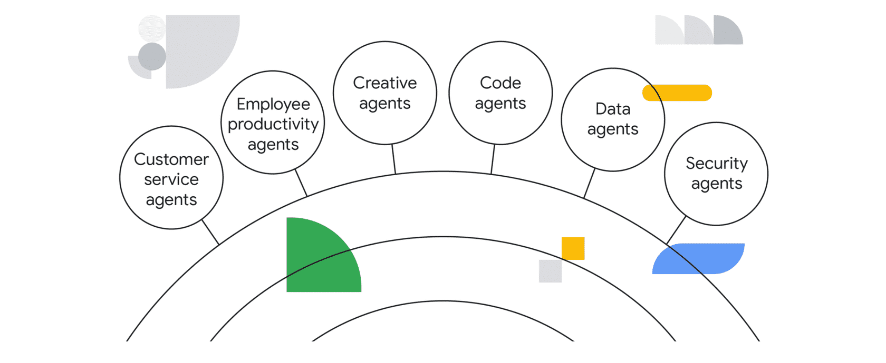

# 01 — Agent Foundations, Architecture & Platform Selection

**Module map:** Covers what AI agents are, how foundation models, grounding/RAG, tools (MCP), and memory form the agent architecture, core single/multi-agent patterns, enterprise use-case categories, and how to choose among Google Cloud's agent platforms.
**Exam objectives:** Foundational context for `1.1`, `1.2`, `3.1`, `3.2`, `3.3`.
**Prerequisites:** None (first note in module). **Next:** [02 — Gemini Enterprise Search & Workflows](02-gemini-enterprise-search-and-workflows.md)

---

## 1. From Traditional ML and Chatbots to AI Agents `[3.1]`

* **Artificial Intelligence (AI) & Machine Learning (ML):** AI refers to computer systems performing tasks that typically require human intelligence; ML is a subset where systems learn patterns from data. Traditional ML models are trained for a single, narrow purpose (e.g., spam filtering).
* **Foundation Models & Large Language Models (LLMs):** Foundation models are large models pre-trained on massive, diverse datasets (text, images, code) so they can adapt to many downstream tasks or be fine-tuned on proprietary data. LLMs are a specialized subset focused on understanding and generating language.
* **AI Agent:** A software system powered by an AI model (typically an LLM) that autonomously determines how to achieve a specific user goal by observing its environment, retrieving grounded information, and executing multi-step actions via tools.

| Dimension | Traditional Chatbots / Early Virtual Agents | Modern AI Agents |
| :--- | :--- | :--- |
| **Execution Logic** | Rigid, predefined scripts and rule-based decision trees | Dynamically plans multi-step execution paths |
| **System & Data Scope** | Isolated data source or single script | Invokes tools across multiple interconnected systems |
| **Task Resolution** | Limited to scripted conversational turns | Carries complex tasks to end-to-end resolution within configured guardrails |

**Takeaway:** Unlike traditional chatbots that follow static scripts, AI agents combine LLM reasoning, grounded data access, and autonomous tool execution to complete multi-step goals.

---

## 2. Grounding & Retrieval-Augmented Generation (RAG) `[1.2]`, `[3.2]`

* **Grounding:** Tethering an AI model's output to a specific scope and verifiable, real-world data sources (internal or public) to reduce hallucinations and invented content.
* **Retrieval-Augmented Generation (RAG):** An architectural pattern that dynamically retrieves up-to-date proprietary data at runtime and injects it into the model's prompt without retraining.

```
User Query ─▶ [1. Retrieval] Query connected data sources for relevant snippets
                     │
                     ▼
              [2. Augmentation] Inject snippets + query into LLM prompt context
                     │
                     ▼
              Grounded Response (based strictly on retrieved sources)
```

| Paradigm | Knowledge Scope | How Updates Happen | Risk |
| :--- | :--- | :--- | :--- |
| **Pre-RAG (Static Model)** | Frozen at initial training data | Requires retraining or fine-tuning | Outdated, non-company-specific, or hallucinated answers |
| **Post-RAG (Grounded Agent)** | Live organizational + public data via tools | Update the underlying data store; no retraining | Retrieval quality depends on data connectivity and permissions |

**Takeaway:** Use RAG and grounding—not model fine-tuning—when an agent needs current, verifiable enterprise or real-time public facts.

---

## 3. Core Agent Architecture: Models, Tools & Memory `[3.1]`, `[3.2]`

Every AI agent relies on three architectural pillars to observe, plan, and act across iterations:

1. **Models (Inference & Reasoning Layer):**
   * Provides core reasoning, language comprehension, and planning.
   * **Thinking Models:** Models with built-in *self-reflection* that evaluate multiple reasoning paths or candidate responses internally before emitting a final answer—ideal for complex, multi-step tasks.
2. **Tools & Model Context Protocol (MCP):**
   * **Tools** let an agent interact with external systems (APIs, databases, web browsers).
   * **Model Context Protocol (MCP):** A standardized protocol for agents to discover, access, and invoke tools. Unlike a traditional API, an MCP interface embeds rich semantic metadata and usage instructions directly alongside the endpoint—specifying *how* it is used, the *meaning* of inputs/outputs, and *when/where* to invoke it.
3. **Memory & Active Context Management:**
   * **Context Window (Base Memory):** Immediate working memory populated dynamically during user/agent interactions.
   * **Short-Term & Long-Term Memory:** Supplementary stores integrated to augment the active context window across turns or sessions.
   * **Active Context Management:** Because context windows have finite capacity and noise degrades reasoning, architectures actively *compress*, *summarize*, *prune/discard* irrelevant context, and *retrieve/inject* relevant facts from short- or long-term memory.

**Takeaway:** Models reason, MCP-standardized tools act on external systems with self-describing semantics, and active context management keeps memory concise and relevant.

---

## 4. Core Agentic Patterns `[3.3]`

| Pattern | Topology & Control Flow | Context & Routing Mechanics | Best-Fit Use Cases |
| :--- | :--- | :--- | :--- |
| **Single-Agent (No-Loop)** | Single model + system instructions + optional tools; **no loops, no sub-agents** | Operates on direct instructions and single-pass tool access | Clear, well-defined single objectives; baseline before scaling |
| **Sub-Agent Pattern** | **Main (general) agent** manages the pipeline and offloads subtasks to dedicated **sub-agents** | **Selective context handoff:** main agent passes only targeted context to a specialist, then resumes | Multi-stage pipelines (e.g., invoice processing: coordinator delegates extraction to a parsing sub-agent) |
| **Orchestrator (Router) Pattern** | Entry-point **router agent** classifies intent and forwards to the best downstream specialist | **Intent-based routing:** rapid triage and delegation | Multi-domain systems with distinct specialist agents |

**Takeaway:** Start with a Single-Agent pattern for simple tasks; adopt Sub-Agent (selective handoff) for multi-stage pipelines and Orchestrator/Router for multi-domain triage.

---

## 5. Enterprise Use Cases & Google Cloud Platform Selection `[1.1]`, `[3.1]`

Enterprise agent deployments map to **six core categories**, each tied to concrete business KPIs (e.g., **Code agents** → *developer velocity*; **Security agents** → *threat response time*):



*(Case study example: Zebra Technologies' **Zebra Companion** pairs Gemini with wearables/multimodal inputs across four specialized retail agents: Knowledge Assistant, Merchandising Agent, Sales Agent, and Device Agent.)*

### Choosing the Right Google Cloud Agent Platform

| Platform | Target Builder | Abstraction & Execution Model | Best-Fit Scenario |
| :--- | :--- | :--- | :--- |
| **Gemini** *(Gemini Enterprise)* | Business users / Employees | No-code SaaS UI; out-of-the-box chat, intranet search, and actions | Internal employee productivity, unified enterprise search, quick no-code workflows |
| **Conversational Agents** *(formerly Dialogflow CX)* | Business users / CX teams | Low-code, fully managed; hybrid **deterministic state-machine flows** + generative features | External/internal support bots requiring **predictable, structured, multi-turn** paths (voice/IVR & chat) |
| **CX Agent Studio** | CX teams / Hybrid builders | Low-code, **generative-first** environment **built on ADK**; multi-agent coordination | **Open-ended, non-linear** external customer journeys spanning multiple systems (e.g., support-to-sales handoff) |
| **Gemini Platform** *(ADK + Agent Runtime + Gemini API)* | Software Developers / Engineers | Code-first open-source **ADK** + managed **Agent Runtime** + **Gemini API** | Custom business logic, proprietary algorithms, full inner/outer-loop orchestration control |

**Note on other business tools:** AppSheet + Gemini for App Creation turns spreadsheets into apps via natural language; Agent Designer (Workflow Builder) and ADK Visual Agent Builder provide visual workflow design.

**Takeaway:** Match the platform to control needs—Gemini for internal SaaS productivity, Conversational Agents for deterministic CX, CX Agent Studio for open-ended multi-agent CX, and Gemini Platform (ADK) for code-first custom logic.

---

## 6. Worked Example & Cross-Check

**Scenario:** A field technician services hospital imaging equipment and asks: *"What's our approved repair procedure for this scanner model, and which parts suppliers near this hospital are open right now?"* The team wants minimal hallucinations and current data.

* **Best approach:** Use **RAG** to retrieve repair steps from internal service manuals and **ground** supplier locations/hours in **Google Maps**.
* **Cross-check:**
  * *Why not fine-tune on last year's manuals?* Fine-tuning is Pre-RAG/static—supplier hours change in real time and manuals update (`Section 2`).
  * *Why not pick a larger pretrained model?* Pretrained weights lack proprietary internal repair manuals and live local business hours.

---

## Common Confusions

| Term A | Term B | Key Distinction |
| :--- | :--- | :--- |
| **Grounding** | **Fine-tuning** | Grounding injects live, verifiable facts at runtime (e.g., via RAG or Google Search/Maps); fine-tuning modifies model weights on static training data for style/domain adaptation. |
| **MCP** | **Traditional REST API** | Both expose external capabilities, but **MCP** bundles semantic descriptions of inputs, outputs, and *when/how* an agent should invoke the tool. |
| **Conversational Agents** | **CX Agent Studio** | **Conversational Agents** (Dialogflow CX) is state-machine-first for structured flows; **CX Agent Studio** is generative-first, built on ADK, for non-linear multi-agent customer journeys. |

*Sources: Course Overview & Introduction to Agents on Google Cloud (`gemini-code-1795710966079.md`), Building Agents with Gemini (`building-agents-with-gemini-raw.md`).*
