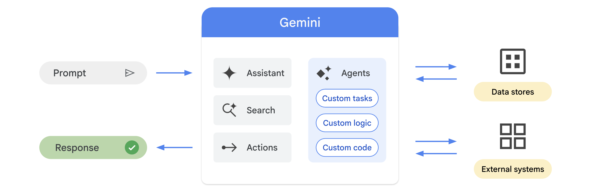

# 02 — Gemini Enterprise Search, Assistant & Agentic Workflows

**Module map:** Covers Gemini (for business / Gemini Enterprise) as an intranet search hub, conversational assistant, and agentic platform; the four agent tiers; the no-code build lifecycle; and RBAC/ACL governance.
**Exam objectives:** `1.2` (Connecting enterprise data to Gemini Enterprise), `1.1` (partial — no-code Agent Designer).
**Prerequisites:** [01 — Agent Foundations, Architecture & Platform Selection](01-agent-foundations-and-architecture.md). **Next:** [03 — Conversational Agents & CX Agent Studio](03-conversational-agents-and-cx-studio.md)

---

## 1. Gemini as a Unified Enterprise Hub `[1.2]`

**Gemini (for business / Enterprise)** is Google's SaaS command center for employees that unifies three capabilities in one interface:
1. **Enterprise-Grade Intranet Search:** Connects to siloed systems (Google Drive, Microsoft SharePoint, Jira, Salesforce, Slack, databases) and uses **semantic and multimodal retrieval** across text, images, videos, audio, and charts—understanding query context rather than mere keywords.
2. **Conversational AI Assistant:** Lets employees ask complex questions, draft content, and choose underlying models.
3. **Agentic Platform:** Supports interactive prompting and background task automation across connected systems.

**End-to-end execution flow:**
`Prompt` → `Assistant / Search / Actions / Agents` ↔ `Data stores & External systems` → `Response`
* **Actions** is the execution stage that interfaces with external systems (e.g., sending an email via a corporate email server/Gmail, posting to Slack, or updating a CRM/ERP via API).

**Security & Grounding:** All search results and agent responses are grounded in private enterprise data while **strictly enforcing source-system Access Control Lists (ACLs) and Role-Based Access Controls (RBAC)**. For example, a sales analyst only sees public pitch summaries, whereas a sales manager can access financial and patent/IP models.

**Takeaway:** Gemini unifies multimodal intranet search, assistant chat, and external `Actions` while enforcing source-system ACLs/RBAC on every query.

---

## 2. Four Agent Tiers in Gemini `[1.1]`, `[1.2]`

| Tier | Who Builds It | Key Tool / Entry Point | When to Use |
| :--- | :--- | :--- | :--- |
| **Premade (Google-built) agents** | Google (ready-to-use) | **The assistant** (Q&A/text, selectable models), **Gemini Notebook** (source-grounded research/writing), **Deep Research** (comprehensive web + enterprise reports) | Immediate out-of-the-box productivity, deep research, or source synthesis without building from scratch |
| **No-code agents** | Business users | **Agent Designer** (Workflow Builder) → published to **Agent Gallery** | Department-specific workflows defined in plain natural language without code |
| **Custom agents** | Developers / Data scientists | **Agent Development Kit (ADK)** | Complex business logic, model fine-tuning, and deep custom system integrations |
| **Partner-made agents** | Third-party ecosystem | **AI agent finder** + pre-built connectors (Salesforce, Jira, SharePoint, Microsoft Copilot) | Integrating external non-Google platforms while respecting source-system ACLs |

### Building a No-Code Agent (4-Step Process in Agent Designer)
1. **Define the purpose:** Specify the exact task clearly and comprehensively.
2. **Connect data:** Link organizational sources (documents, spreadsheets, business apps).
3. **Provide instructions:** Guide behavior in plain natural language (no code).
4. **Improve performance:** Test and iterate in real time, refining instructions based on output quality.

**Takeaway:** Choose **Premade** for immediate generic tasks, **Agent Designer** (no-code) for specialized department workflows without engineering, **ADK** for custom code logic, and **Partner-made** (via AI agent finder) for third-party ecosystems.

---

## 3. Enterprise Boundaries: What Gemini Automates vs. Human-in-the-Loop `[1.2]`

Gemini streamlines cross-departmental work across sales (company summaries, multi-source account histories across Drive/Salesforce/Slack, event-driven Gmail follow-ups), technical ops (automating deployments/pipelines, proactive bug identification, performance data analysis), marketing (campaign analysis, log/social issue insights), and admin (reimbursements, PTO, payslips, scheduling).

However, high-stakes external commitments remain **human-owned**—agents do **not** autonomously conduct live customer presentations, automatically close deals, or negotiate/finalize legal terms of high-value contracts.

**Takeaway:** Gemini automates research, synthesis, drafting, and routine operational actions, leaving final deal closure and legal negotiation to humans.

---

## 4. Worked Example: Cymbal Labs Unified Knowledge Base `[1.2]`

* **Problem:** Cymbal Labs' sales reps manually cross-reference fragmented CRM (contacts/pipeline), ERP (COGS/financial models), documents (legal/IP), and Slack/email threads before client calls.
* **Solution:** Cymbal Labs connects these silos to Gemini using built-in connectors and three pre-built agent patterns:
  1. **Pre-built Knowledge Agent (Federated RAG):** Answers multi-system natural-language queries with citations and generates a complete customer snapshot, presentation deck, and initial quote.
  2. **Communication Agent:** Uses integrated `Actions` to update internal trackers, draft personalized partner emails, and post Slack alerts to finance.
  3. **Pre-built Action Agent:** Connects to financial and CRM systems via API connectors to reconcile 2-year partner milestone and payment history.
* **Cross-check (Quiz verification):**
  * *Primary function of Gemini:* Central command center for employees to find information and accomplish complex tasks using AI agents (not just a customer-service chatbot or public-only search).
  * *Interfacing with corporate email server to send an incident report:* Handled by the **Actions** stage (after Search and Summarization).
  * *Need a specialized data-analysis agent without building from scratch, when default general-purpose agent is insufficient:* Select **Custom agents built with Agent Designer** (if no-code tailored) or **Google premade agents** depending on whether a ready-made Google specialist exists—note that in the module quiz, *Custom agents built with Agent Designer* is contrasted against the default general-purpose agent when avoiding building from scratch in code.

---

## Common Confusions

| Term A | Term B | Key Distinction |
| :--- | :--- | :--- |
| **Agent Designer** *(Workflow Builder)* | **Agent Gallery** | **Agent Designer** is the no-code visual tool used to *build* agents; **Agent Gallery** is the catalog where published agents are *discovered and accessed* across departments. |
| **Agent Designer** | **AI agent finder** | **Agent Designer** creates internal no-code agents; **AI agent finder** discovers *partner-made* third-party agents. |
| **Search** | **Actions** | **Search** retrieves and grounds information from data stores; **Actions** executes side effects in external systems (sending emails, updating CRM/Slack). |

> [!NOTE]
> **Gap (`1.2`):** The exam guide also expects details on **ingesting and processing unstructured multimodal data** (videos, audio, images) into the agentic workflow. This course notes that Gemini search supports multimodal retrieval across text, images, videos, audio, and charts, but does not cover ingestion pipelines or metadata schemas (covered in *Improve Agent Search Findings*).

*Sources: Gemini: Intranet search, AI assistant, and agentic workflows (`gemini-intranet-search-ai-assistant-and-agentic-workflows-raw.md`, `gemini-code-1795710966079.md`).*
